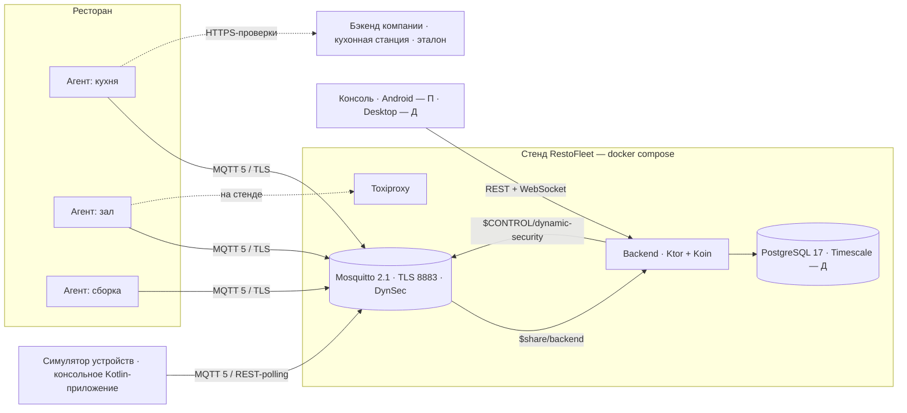
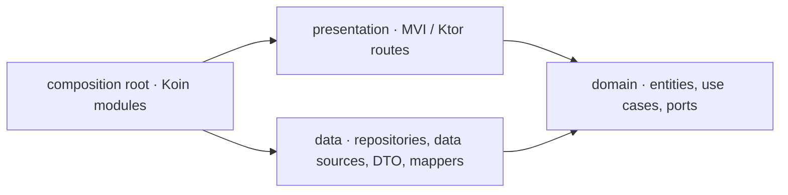
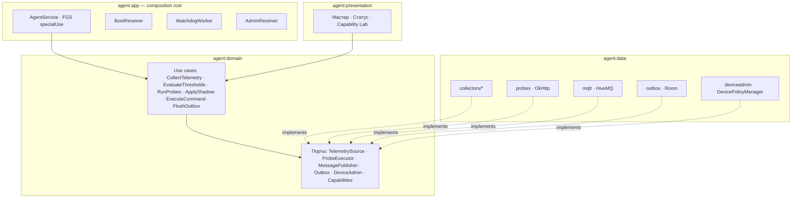

# RestoFleet — архитектура

**Версия:** 2.1 (согласована с черновиком ТЗ v0.3; правки по итогам MVP-A) · **Дата:** 10.11.2026 · **Статус:** на согласовании
Документ содержит **только общее для всех этапов**: решения, слои, структуру, канон MVI, тесты, протокол, безопасность. Всё, что делается на конкретном этапе, — в файлах этапов (разд. 11). Дорожная карта — [plan.md](plan.md), макеты — `docs/design/restofleet-blueprint.html`.

Этапы: **MVP** (проверка осуществимости) → **К** (курсовая: ядро — агент + MQTT) → **П** (практика: тревоги, инциденты, Android-консоль) → **Д** (диплом: Device Owner, Desktop-консоль, масштаб, VPS).

---

## 1. Ключевые решения

| # | Решение | Кем принято | Почему |
|---|---|---|---|
| D1 | **Весь код на Kotlin**: агент, консоль, бэкенд (Ktor), симулятор. Go не используем | Пользователь | Общий модуль протокола исключает расхождение форматов между агентом, бэкендом и симулятором |
| D2 | **Clean Architecture везде** — консоль, агент, бэкенд: слои domain / data / presentation, правило зависимостей проверяется Gradle-модулями и архитектурными тестами | Пользователь | — |
| D3 | **Большая часть кода покрыта unit-тестами**: Kover-гейт в CI, ≥ 80 % строк по проекту (без UI-разметки, DI, сгенерированного кода), domain ≥ 90 % | Пользователь (цифры — мои) | ТЗ требовало ≥ 60 % только для домена бэкенда — поднимаем |
| D4 | Фичевые модули по образцу `kmp-architecture-samples`: `feature/<f>/{<f>-domain, <f>-data, <f>-ui, <f>-component}` | Пользователь | — |
| D5 | Presentation консоли и агента — канон MVI из новых фич `white-label-android`, адаптированный под Decompose | Пользователь | — |
| D6 | DI — **Koin 4 на всех частях**, включая Ktor-бэкенд (`koin-ktor`); навигация консоли — Decompose 3 | Пользователь (бэкенд), мой выбор (Koin) | Один DI-фреймворк на весь проект; `koin-test verify()` проверяет граф в unit-тесте |
| D7 | **Без convention-плагинов**: у каждого модуля свой `build.gradle.kts`, все версии, плагины, `compileSdk/minSdk/jvmTarget` — в `gradle/libs.versions.toml` | Пользователь | Повторяется только структура блоков; любая версия меняется в одном месте |
| D8 | **Сначала MVP** — проверка всех считываний агента и Device Owner на эмуляторах и реальном устройстве до старта курсовой | Пользователь | Невыполнимое требование выявляется в начале, а не в дипломе |
| D9 | Курсовая — **минимальное ядро**: протокол MQTT + агент + брокер + ядро бэкенда + симулятор + эксперимент. Консоль, тревоги, инциденты — в П/Д | Пользователь | — |
| D10 | Mosquitto 2.1 + **Dynamic Security с курсовой** | Мой выбор, правка ТЗ | Провижининг создаёт/отзывает учётки на лету; `password_file` в 2.1 устарел |
| D11 | PostgreSQL — сразу образ `timescale/timescaledb:2.x-pg17`, гипертаблицы включаются в Д | Мой выбор | Не мигрировать движок в дипломе |
| D12 | Рестораны: в К — CRUD-эндпоинты и dev-seed из YAML для стенда и симулятора; в Д — **добавление и правка в Desktop-консоли**. Импорта из CSV нет | Пользователь | Dev-seed — не функция продукта, а тестовые данные стенда |
| D13 | Консоль: Android (смартфон, одна панель) — П; Desktop (список + карточка рядом) — Д. Стиль «операционный центр», две темы | Пользователь | — |
| D14 | Стенд: MVP/К/П — локально (docker compose), Д — VPS | Пользователь | — |
| D15 | Реальные устройства: планшет Android 8.0 (можно сбросить → Device Owner) и телефон Android 12 (обычный режим); доступны позже — проверка на них вынесена в MVP-B | Пользователь | — |
| D16 | SDK: `minSdk 26`, `targetSdk 36`, `compileSdk 37` (константы разрешения на локальную сеть); при `targetSdk 37` нужно разрешение на локальную сеть (P3) | Пользователь (ТЗ), решения MVP 2, 47 | Поведение на API 37 фиксируется в Capability Lab |
| D17 | Качество: detekt **2.0.0-alpha.6** (1.23.8 не поддерживает Kotlin 2.4); при поломке detekt отключается в CI отдельным коммитом, Kotlin не откатываем | Согласовано 06.11.2026, решение MVP 1 | Версия закреплена в toml |

**Допущение (не подтверждено):** сейчас инженер поддержки при обращении «бэкенд не работает» звонит в ресторан и смотрит серверные логи — данных о том, *как ресторан видит бэкенд*, у него нет. Под это спроектирован экран «Инциденты» (П). Проверяется на интервью в П1.

---

## 2. Состав системы



Консоль **никогда** не подключается к брокеру — только REST + WS к бэкенду.

**Симулятор устройств** — обычная консольная программа на Kotlin, которая запускается на компьютере или в docker (не на Android; «JVM» означает именно это — Kotlin под обычную Java-машину). В одном процессе она изображает сотни и тысячи «виртуальных агентов»: каждый подключается к брокеру со своей учёткой, шлёт правдоподобную телеметрию и проверки, принимает тень и команды — ровно по тому же протоколу, что настоящий агент. Нужен потому, что тысяч реальных планшетов нет, а проверить нужно: нагрузку (1 000 / 10 000 устройств), эксперимент MQTT vs REST-polling и сценарии отказов для классификатора инцидентов.

---

## 3. Clean Architecture

### 3.1 Правило зависимостей



| Слой | Содержит | Не может зависеть от |
|---|---|---|
| **domain** | Сущности и value objects (`Device`, `Restaurant`, `ProbeTarget`, `ShadowParams`…), интерфейсы репозиториев и портов (`DeviceRepository`, `TelemetrySource`, `MessagePublisher`), use cases (один публичный `operator fun invoke`), доменные ошибки (`sealed DomainError`) | Android SDK, Ktor, Exposed, Room, HiveMQ, kotlinx-serialization, Koin, Decompose |
| **data** | Реализации репозиториев/портов, источники данных (remote / local / platform), DTO (`@Serializable`), мапперы DTO ↔ domain | presentation |
| **presentation** | Консоль/агент: MVI (ViewModel, Reducer, UiState, Compose). Бэкенд: Ktor routes, request/response DTO, маппинг ошибок в HTTP | data (только через domain-интерфейсы) |
| **composition root** | Koin-модули, `Application`/`main`, Decompose-компоненты | — |

- Протокол MQTT (`shared:protocol`) — это **DTO транспорта**, т.е. слой data. Domain о JSON и топиках не знает; мапперы `TelemetryDto ↔ TelemetrySnapshot` — в data.
- Ошибки: data превращает исключения в `DomainError` (тип `Outcome<T, E>` в `shared:kernel`; имя выбрано, чтобы не затенять `kotlin.Result`); presentation превращает `DomainError` в UI-сообщение или HTTP-статус.
- Время и случайность — через порты `Clock`, `IdGenerator`: use cases детерминированно тестируются.
- **Изоляция сбоев на границе** (решения 27, 78, 82): каждое считывание, проверка Lab и тик цикла — в своём `try`. Ловится `Exception`, `Error` пробрасывается. `CancellationException` на границе не пробрасывается вслепую: `currentCoroutineContext().ensureActive()` отделяет настоящую отмену (наружу) от бродячей (внутренний `withTimeout`, `Future.get()` отменённого future) — та считается сбоем одного считывания. У каждого считывания свой таймаут (5 с), блокирующие вызовы идут через `runInterruptible` на IO.
- **Архитектурные тесты:** Konsist (`konsist` в `jvmTest`/`test`) проверяет, что `..domain..` не импортирует `android.*`, `io.ktor.*`, `org.jetbrains.exposed.*`, что use case имеет один публичный `invoke`, что ViewModel не ссылается на data-классы.

### 3.2 Как слои раскладываются по частям

| Часть | domain | data | presentation | composition root |
|---|---|---|---|---|
| Консоль (на фичу) | `<f>-domain` (KMP) | `<f>-data` (KMP: Ktor client, DTO) | `<f>-ui` (Compose MP + MVI) | `<f>-component` (Decompose + Koin) |
| Агент | `agent:domain` (KMP) | `agent:data` (Android: коллекторы, Room, HiveMQ, OkHttp, DPM) | `agent:presentation` (Compose + MVI) | `agent:app` (Application, Service, Receivers, Koin) |
| Бэкенд | `server:domain` (JVM) | `server:data` (Exposed, Flyway, HiveMQ, DynSec) | `server:api` (Ktor routes) | `server:app` (`main`, Koin, конфиг, CLI) |
| Общее | `shared:kernel` (KMP: `DomainError`, `Clock`, `Outcome`) | `shared:protocol` (KMP: DTO транспорта) | — | — |

Чистая логика, которую используют несколько частей, живёт в `shared:*` как **domain-код** без зависимостей: `shared:shadow` (delta, версии, merge профилей), `shared:probes` (автомат up↔down, классы ошибок).

---

## 4. Структура репозитория

```
restofleet/
├─ settings.gradle.kts
├─ build.gradle.kts                 только plugins { … apply false } + Kover-агрегатор
├─ gradle/libs.versions.toml        версии, библиотеки, плагины, sdk-уровни (compileSdk/minSdk/targetSdk), jvmTarget
├─ config/detekt/detekt.yml     переопределения detekt 2 (путь по умолчанию)
├─ konsist-tests/               архитектурные тесты Konsist (JVM, читают исходники с диска)
├─ spikes/                      одноразовые спайки (MVP: broker-load), вне Kover
├─ tools/                       dummy-waiter, emulators/, dev/ (служебные скрипты)
│
├─ shared/                          ── подключают агент, консоль, бэкенд, симулятор
│  ├─ kernel/      KMP   DomainError, Outcome, Clock, IdGenerator                       MVP
│  ├─ protocol/    KMP   DTO MQTT/REST, Topics, RfJson + golden-фикстуры                MVP→К
│  ├─ shadow/      KMP   delta, версии · merge профилей — Д                              К
│  └─ probes/      KMP   K-fail автомат up↔down, классификация ошибок, расписание        К
│
├─ agent/
│  ├─ domain/       KMP      сущности, порты (TelemetrySource, ProbeExecutor, MessagePublisher,
│  │                         Outbox, DeviceAdmin…), use cases (CollectTelemetry, EvaluateThresholds,
│  │                         RunProbes, ApplyShadow, ExecuteCommand, FlushOutbox), Capabilities
│  ├─ data/         Android  collectors/*, probes (OkHttp + EventListener), mqtt (HiveMQ),
│  │                         outbox (Room), provisioning (Keystore), deviceadmin (DPM) …
│  ├─ presentation/ Android  MVI-экраны: мастер настройки, статус, Capability Lab (MVP)
│  └─ app/          Android  Application, AgentService (FGS), BootReceiver, Watchdog, AdminReceiver, Koin
│
├─ server/
│  ├─ domain/       JVM   сущности, порты, use cases: provisioning, ingest, presence, shadow,
│  │                      commands, restaurants (CRUD, без импорта из CSV) · alerts, incidents — П · profiles, rules — Д
│  ├─ data/         JVM   Exposed-репозитории, Flyway-миграции, HiveMQ ingest/publisher, DynSecClient
│  ├─ api/          JVM   Ktor routes /api/v1/**, OpenAPI + Swagger UI, StatusPages, WS · REST-polling
│  ├─ app/          JVM   main, Koin-модули, конфиг, CLI: `seed`, `migrate`
│  └─ simulator/    JVM   симулятор устройств (domain/data/app — пакетами внутри модуля)
│
├─ console/                                                                   П (Android) · Д (Desktop)
│  ├─ core/  common · mvi · decompose · network · storage · designsystem · ui · testing   (KMP)
│  ├─ root/ · app-android/ · app-desktop/
│  └─ feature/<f>/{<f>-domain, <f>-data, <f>-ui, <f>-component}
│        auth · dashboard · restaurants · devices · device-details · shadow · commands ·
│        alerts · provisioning · incidents                                     — П
│        availability · profiles · rules · reports                             — Д
│
├─ deploy/    docker-compose.yml, mosquitto/ (conf, dynsec), toxiproxy.json, certs/make-ca.sh,
│             seed/ (dev: restaurants.yaml, users.yaml), .env.example
└─ docs/      ТЗ, architecture.md, plan.md, stages/ (0-mvp, 1-coursework, 2-practice, 3-diploma),
              protocol/fixtures, openapi.yaml, experiments/, design/
```

**Почему у агента 4 модуля, а не по модулю на коллектор:** без convention-плагинов каждый модуль — отдельный `build.gradle.kts`; слои разделены модулями, а внутри data — пакетами (`collectors/`, `probes/`, `mqtt/`, `outbox/`, `deviceadmin/`). Модуль выносится отдельно, только когда растёт время сборки.

**Сборка без convention-плагинов** — шаблон KMP-модуля:
```kotlin
plugins {
    alias(libs.plugins.kotlin.multiplatform)
    alias(libs.plugins.android.kotlin.multiplatform.library)
    alias(libs.plugins.kotlinx.serialization)
    alias(libs.plugins.kover)
}
kotlin {
    androidLibrary {
        namespace = "ru.restofleet.shared.protocol"
        compileSdk = libs.versions.android.compileSdk.get().toInt()
        minSdk = libs.versions.android.minSdk.get().toInt()
    }
    jvm()
    sourceSets {
        commonMain.dependencies { implementation(libs.kotlinx.serialization.json) }
        jvmTest.dependencies { implementation(libs.junit4); implementation(libs.truth) }   // Truth — только JVM
    }
}
```

**Правила зависимостей модулей**
- Фича консоли не зависит от другой фичи; переходы — `Output`-колбэки компонентов, связывает родитель.
- `-ui` и `-domain` не знают о Decompose; `-component` собирает фичу.
- Модули `domain` зависят только от `shared:kernel` (и `shared:shadow`/`shared:probes`, которые сами — чистый домен).
- MQTT-клиент живёт в `agent:data` и `server:data`/`simulator` — не в `shared` (консоли MQTT не нужен).

---

## 5. Presentation-слой (канон MVI)

Источник канона: `white-label-android/docs/architecture/mvi.md`, эталон — `feature/cart/details`, `feature/catalog/screens/sort`.

```
<f>-ui/.../feature/<f>/ui/
  <F>Screen.kt          @Composable (uiState, onIntent) + @Preview — без ViewModel
  <F>Container.kt       берёт ViewModel, collectAsState, ObserveEffects → Screen
  view/section/*.kt     секции экрана  (не "component" — слово занято Decompose)
  api/I<F>Router.kt     навигация наружу
  viewmodel/
    <F>ViewModel.kt     : BaseMviViewModel<Session, UiState, Intent, Action, Effect>; зависит только от use cases
    <F>Intent.kt        sealed: User.* / External.*
    <F>Action.kt        только то, что обрабатывает Reducer; ветка else запрещена
    <F>Reducer.kt       чистая функция (Session, Action) -> Session
    <F>Effect.kt        одноразовые события: ShowSnackbar, ShowDialog…
    <F>UiState.kt       @Immutable
    model/<F>Session.kt источник истины
    mapper/<F>UiStateMapper.kt   Session -> UiState
<f>-component/.../component/
  <F>Component.kt      ComponentContext, retainedViewModel { get() }, реализация I<F>Router
  di/<F>Module.kt
```

Адаптации к KMP/Decompose:
1. `BaseMviViewModel` реализует `InstanceKeeper.Instance`, свой scope отменяется в `onDestroy`; API идентичен white-label: `uiState: StateFlow`, `effect: Flow`, `onIntent()`, защищённые `reduce()`/`emitEffect()`.
2. Навигация — вызов `I<F>Router` из `onIntent`, не `Effect`.
3. Эффекты собирает ровно один подписчик — `ObserveEffects` в `<F>Container`.
4. `MviStore.dispatch` — только на Main (на Desktop — EDT); тяжёлая работа ViewModel (проверки, экспорт) идёт через инжектируемый IO-диспетчер, флаги прогресса сбрасываются в `finally`, на scope стоит `CoroutineExceptionHandler` (решения 61, 79, 86).
5. Только coroutines/Flow; Koin только через конструктор, `KoinComponent` вне composition root запрещён.

Агент использует тот же канон для своих экранов (мастер, статус, Capability Lab) — `core:mvi` подключается как зависимость.

---

## 6. Стратегия тестирования

| Слой / что | Чем тестируем | Цель покрытия |
|---|---|---|
| domain (use cases, сущности, `shared:*`) | unit, JUnit 4 + Truth (`src/jvmTest`) + фейки портов; табличные тесты для правил и классификатора | ≥ 90 % |
| data: мапперы, логика репозиториев | unit с фейковыми источниками | ≥ 80 % |
| data: Exposed-репозитории, Flyway | интеграционные, Testcontainers PostgreSQL | все запросы |
| data: MQTT (бэкенд, симулятор) | интеграционные, Testcontainers Mosquitto (DynSec, LWT, retained, expiry) | ключевые сценарии |
| data: Android-адаптеры (коллекторы, DPM) | логика вынесена в чистые функции (`BatteryReading.from(level, scale, …)`) — unit; тонкий слой вызовов Android — Robolectric где возможно, иначе Capability Lab на эмуляторе/устройстве | ≥ 70 % |
| presentation: Reducer, UiStateMapper, ViewModel | unit, Turbine для Flow, фейковые use cases и роутер | ≥ 85 % |
| presentation: Ktor routes | `testApplication` с фейковыми use cases | все эндпоинты |
| протокол | golden-фикстуры `docs/protocol/fixtures/*.json`: round-trip в `shared:protocol` | 100 % сообщений |
| DI | `koin-test`: `verify()` для каждого Koin-модуля | все модули |
| архитектура | Konsist: правило зависимостей, именование | — |

Инструменты: **JUnit 4 + Google Truth** во всех модулях (тесты KMP-модулей — в `src/jvmTest`, т. к. Truth работает только на JVM; `kotlin.test` — только `assertFailsWith`), ручные фейки портов в domain (Mokkery не используется — решение MVP), **MockK** (только JVM/Android-модули), Turbine, Robolectric, Testcontainers, Ktor test host, Konsist, **Kover** (агрегированный отчёт в корне, гейт в CI: общий ≥ 80 % по варианту `ci` — задача `koverVerifyCi`; модуль подключается к гейту через `kover(project)` в корне и свой вариант `ci`; исключения — `@Composable`, `*Module*`, `di/`, `*Activity`, `*Service`, `*Receiver`, `*Worker`, сгенерированное). Разработка — TDD: тест use case пишется до реализации.

---

## 7. Протокол — правки к разделу 7 ТЗ

Модели — `shared:protocol`; golden-фикстуры — `docs/protocol/fixtures/*.json`. В ТЗ v0.3 правки P1–P10 внесены в разд. 7.4.

| # | Проблема в v0.2 | Правка |
|---|---|---|
| P1 | Статус `delivered` средствами MQTT не узнать | Агент сразу публикует `cmd/res` со `status: "received"`, затем итоговый |
| P2 | `expired` брокер молча не сообщает | Поле `expiresAt` в `cmd/req` (+ Message Expiry брокера); бэкенд переводит в `expired` по таймеру; поздний итоговый ответ побеждает. Агент с истёкшим `expiresAt` не исполняет команду и отвечает `failed` / `expired` (решение MVP 11) |
| P3 | LWT старой сессии может прийти после нового `online` | `connId` в `online` и в LWT; чужой `connId` игнорируется |
| P4 | Shared subscription не получает retained | Источник истины статуса — БД |
| P5 | ACL `%u/#` позволяет устройству писать себе `desired`/`cmd/req` | Роль DynSec `device`: publish — `status, telemetry, probe, events, shadow/reported, cmd/res`; subscribe — `shadow/desired, cmd/req` |
| P6 | Client ID не привязан к учётке | DynSec-клиент с `clientid = deviceId` |
| P7 | R-01 «> 2 мин» против S2 «≤ 95 с» и NFR «≤ keepalive × 1,5 + 5 с» | Keepalive 30 с, R-01 сразу по LWT (grace настраивается, по умолчанию 0) ⇒ ≈ 50 с |
| P8 | Нет persistence брокера | `persistence true` + volume; очистка retained при выводе из эксплуатации |
| P9 | Аутентификация REST-polling не описана | HTTP Basic учёткой устройства; бэкенд хранит bcrypt-хэш пароля в `device_credentials` |
| P10 | Без ручного ack «без потерь QoS 1» не выполняется | Стабильный clientId, `Clean Start=false`, ack после commit пакета в БД (агент подтверждает входящие после обработки, решение 149) |

Дополнения по итогам MVP-A (ТЗ v0.3, разд. 7.4–7.5):
- **Дедупликация at-least-once:** `cmd/res` — по `(cmdId, status)`; у событий идентификатора нет, возможен одиночный дубль при обрыве досылки (решение 133) — OQ-2.
- **`expiresAt` по часам устройства:** при уходе часов вперёд > 5 мин все команды получают `expired`; допуск или опора только на Message Expiry — OQ-1.
- **Валидация `desired`:** `telemetry.intervalSec` 10..3600, неверное значение не применяется, причина в `errors` (решения 134, 177, Ruling 279).
- **Повторы:** `auth_failed` 15 → 30 → 60 мин, `session_taken_over` (0x8E) 5 мин + jitter, прочее 1..120 с (решения 152, 173, 176).
- **Outbox:** окончательные отказы PUBACK (0x87, 0x90, 0x97, 0x99) удаляются, временные — нет (решение 171).
- **Формат:** `cmd/res.result` — объект со строковыми значениями (решение 123); `status` несёт `connId`, `bootId`, `device` (решение 151).

---

## 8. Backend (Ktor + Koin, Clean Architecture)

```
server/domain/  ru.restofleet.server.domain.
  restaurant/   Restaurant, RestaurantRepository, Create/Update/List/GetRestaurantUseCase          — К
  device/       Device, DeviceRole, DeviceRepository, RegisterDeviceUseCase, DecommissionDeviceUseCase — К
  provisioning/ ProvisioningToken, IssueTokensUseCase, ProvisionDeviceUseCase, BrokerAccounts (порт)   — К
  ingest/       TelemetrySnapshot, ProbeReport, DeviceEvent, IngestBatchUseCase                     — К
  presence/     Session, HandleStatusUseCase (connId)                                              — К
  shadow/       Shadow, UpdateDesiredUseCase, HandleReportedUseCase (shared:shadow)               — К
  command/      Command, CommandStatus, SendCommandUseCase, HandleCommandResultUseCase, ExpireCommandsUseCase — К
  alert/        RuleEngine (R-01…R-06), Alert lifecycle                                           — П
  incident/     ProbeAggregator, IncidentClassifier (R-07…R-09)                                    — П
  profile/ rule/ audit/ report/                                                                     — Д
server/data/    Exposed-таблицы и репозитории, Flyway (resources/db/migration), HiveMqIngest
                (Channel → пакет 500 шт / 500 мс → IngestBatchUseCase → ack), HiveMqPublisher,
                DynSecBrokerAccounts ($CONTROL/dynamic-security/v1), BcryptHasher, SystemClock
server/api/     routes/ (restaurants, devices, provisioning, shadow, commands, health, poll), dto/,
                StatusPages (DomainError → HTTP), OpenAPI + Swagger UI, auth (JWT) · ws/ — П
server/app/     Main.kt (install(Koin) { modules(domainModule, dataModule, apiModule, appModule) }),
                AppConfig (hoplite), CLI: `migrate`, `seed` (только dev: deploy/seed/*.yaml через Create-use cases)
```

Koin: use cases — `factoryOf(::SendCommandUseCase)`, репозитории и клиенты — `singleOf(...) bind Port::class`; routes получают use cases через `inject()` **только в `Application.module`** (composition root), в обработчики передаются параметрами. `KoinVerify` в тесте `app`.

**Стек:** Ktor 3.x (Netty, ContentNegotiation, StatusPages, Auth-JWT, RateLimit, WebSockets — П) · Koin 4 (`koin-ktor`, `koin-logger-slf4j`) · Exposed DSL 1.x + `exposed-json` · HikariCP · pgjdbc · Flyway (`flyway-database-postgresql`) · HiveMQ MQTT Client 1.4 · hoplite · bcrypt · logback + kotlin-logging · Testcontainers.

**Модель данных** — таблицы добавляются по этапам; состав и миграции каждого этапа описаны в его файле (разд. 11).

---

## 9. Android-агент (Clean Architecture)



- **Outbox:** события, `shadow/reported`, `cmd/res` сначала пишутся в Room и удаляются по PUBACK — «без потери событий за 24 ч офлайна». Телеметрия и пробы при связи идут сразу (QoS 0), без связи — в буфер.
- **Capabilities:** доменная матрица «что доступно на этом устройстве» (режим normal/DO, уровень API, выданные разрешения, наличие датчиков). Use case `ExecuteCommand` по ней возвращает `unsupported` с причиной. Матрица заполняется результатами MVP.
- **Привилегированная поверхность только в debug (M2, решение 140):** экран Device Owner (тихая установка APK по URL, киоск, перезагрузка), ручной запуск команд C1–C4 в Lab, самовыдача разрешений и подтягивание хэша подключает `privilegedModule` из `agent/app/src/debug`; в release одноимённый модуль пуст, вкладки и ViewModel нет. Исполнитель `ExecuteCommand` остаётся в обоих вариантах (команды по MQTT). Защита проверяется юнит-тестами release (`*ReleaseTest`) и задачей `verifyReleaseNoDebugSurface` (манифест без `testOnly`, `debuggable`, `networkSecurityConfig`, `DevConfigReceiver`).
- **Двухфазный `reboot` (решение 142):** `DeviceAdmin.reboot()` планирует перезагрузку через 3 с и сразу отвечает; `HandleIncomingCommand` кладёт итог `succeeded` команды `Reboot` в Outbox (персистентно), а не публикует напрямую; после загрузки досылка отправляет его (досылку запускает сессия, задача 3.6).
- **Киоск (решение 141):** `Capabilities.kioskActive` и allowlist lock task; под киоском `show_message` и `launch_app` чужого пакета отвечают `failed`/`kiosk_active`, а не ложным успехом. Восстановление киоска после перезагрузки и выход из него — кандидаты в требования (ТЗ v0.3, разд. 17.2).
- **`install_update` (решение 143):** команда несёт `package`; ставится только пакет из `WatchedApps` (статический список ∪ `shadow.watchedApps`), установщик получает `setAppPackageName`, результат — `{package, versionCode, versionName}`. **Граница доверия (решение 161):** сервер, шлющий `desired` и `install_update`, — один доверенный субъект; подписанный allowlist — кандидат (ТЗ 17.2). Пакеты из `desired` попадают в `package_changed` после перезапуска агента.
- **MQTT-сессия агента (3.6a, решения 148–157):** `MqttBrokerSession` (data) реализует `BrokerSession` и `MessagePublisher` над тонкой границей `MqttLink` (HiveMQ только в `HiveMqLink`). Порядок подключения: учётка -> CA стенда (fail closed, пиннинг + проверка SAN) -> CONNECT с will (`status offline/lwt`, свежий `connId` на каждую попытку) -> `online` с тем же `connId` -> подписки QoS 1 -> `CONNECTED` -> досылка outbox. Входящие команды и `desired` — холодные потоки: ack после `HandleIncomingCommand`/`ApplyDesiredShadow`. `SessionRuntime` запускает циклы (`SessionSupervisor`: команды, `desired`, досылка при подключении и раз в 60 с; `EventPump`: сеть, пакеты, жизненный цикл) в процессном scope. Смена учётки (`NotifyingCredentialStore`) перезапускает сессию.
- **Устойчивость сессии и outbox (исправления M3, решения 170–178):** отказ брокера в PUBACK/SUBACK виден кодом (`not_authorized`, `puback_<имя>`), а не `connect_failed`. Окончательный отказ (`MessageRejected`: PUBACK `0x87`, `0x90`, `0x97`, `0x99`) удаляет запись outbox без повтора, досылка идёт дальше. Досылка держит замок только на пачку (50); коллектор команд досылает лишь итоги команд (`FlushScope.COMMAND_RESULTS`) и не ждёт телеметрию. `auth_failed` повторяется редко (15..60 мин), `session_taken_over` — через 5..6 мин; временный сбой Keystore даёт `credentials_unavailable` с повтором, учётка не стирается. Итерация цикла сессии изолирована, у процессного scope есть `CoroutineExceptionHandler`. Неверный интервал в `desired` оставляет прежний.
- **Capability Lab** (MVP, остаётся как отладочный экран): по каждому считыванию и DO-действию — статус, сырые значения, кнопка «отправить в MQTT».
- **Жизненный цикл агента (M1):**
  - Цикл телеметрии (тик каждые 30 с) крутится в `AgentCycle` на инжектируемом IO-диспетчере, не на Main (решение 61).
  - Пока цикл работает, держится `PARTIAL_WAKE_LOCK` `RestoFleet:agent` — иначе в suspend тики останавливаются. Владелец замка — последний `Lease`: устаревший цикл не может снять замок нового (решения 81, 88).
  - `startForeground` вызывается через шов `ForegroundStarter` и защищён: отказ системы пишется в журнал как `start_denied`/`start_failed`, сервис останавливается с `START_NOT_STICKY` (решение 80).
  - Журнал жизненного цикла и heartbeat — файлы с атомарной починкой оборванного хвоста, запись best effort (решения 49, 62, 63).
  - L3 = ✅ только после наблюдённого перезапуска сторожем (решение 84).
- **Отчёт Capability Lab:** JSON (`JsonCapabilityReportWriter`: tmp + `ATOMIC_MOVE`, `.tmp` удаляется в `finally`) пишется во внешний каталог приложения `Android/data/ru.restofleet.agent/files/`; в отчёт не попадают IMEI, MAC и серийный номер (решения 73, 87). «Экспорт» во время «Запустить всё» игнорируется (решение 86).

---

## 10. Симулятор устройств

- Консольное Kotlin-приложение (`server:simulator`), запускается из IDE, `./gradlew :server:simulator:run` или как docker-контейнер.
- Использует `shared:protocol`, `shared:probes`, `shared:shadow` и HiveMQ client — поведение совпадает с агентом.
- Один процесс, корутина на устройство; клиенты HiveMQ на общем Netty event loop; плавный разгон подключений с jitter.
- Регистрирует устройства тем же путём, что агент: `POST /provisioning/tokens:batch` → `/provision` для каждого; учётки кэшируются в файле. Устройства распределяются по ресторанам, уже существующим в БД.
- Профили (кухня / зал / сборка), сценарии в YAML, результаты в CSV. Режимы проверок: `real` (через Toxiproxy) и `synthetic` (результат задаёт сценарий, пишет ground truth — П).
- Деградация сети в эксперименте: задержка — Toxiproxy перед брокером/бэкендом, потери пакетов — `tc netem` в контейнере симулятора (`cap_add: NET_ADMIN`).
- Риск 10 000 клиентов на JVM проверяется в MVP (спайк S1, одноразовый модуль `spikes/broker-load`); результат ⏳ M4; запасной план — симулятор на Go.

---

## 11. Файлы этапов

| Этап | Файл | Что внутри, помимо задач |
|---|---|---|
| MVP | [stages/0-mvp.md](stages/0-mvp.md) + [stages/0-mvp-feasibility.md](stages/0-mvp-feasibility.md) | Capability Lab, матрица проверок, стенд MVP-A/MVP-B |
| Курсовая | [stages/1-coursework.md](stages/1-coursework.md) | Модель данных ядра, рестораны (CRUD + dev-seed), симулятор и эксперимент, демонстрация без консоли |
| Практика | [stages/2-practice.md](stages/2-practice.md) | Правила и тревоги, корреляция инцидентов, Android-консоль и её навигация |
| Диплом | [stages/3-diploma.md](stages/3-diploma.md) | Device Owner, безопасность, профили, Desktop-консоль (в т.ч. рестораны), Timescale, VPS |

---

## 12. Безопасность

- Свой CA стенда (`deploy/certs/make-ca.sh`), SAN: `localhost`, `10.0.2.2`, IP машины в локальной сети (для реальных устройств), `mosquitto`, `backend`, `toxiproxy`; в Д — домен VPS. Агент пиннит CA стенда.
- Брокер: только 8883, `allow_anonymous false`, DynSec; пароль устройства — 32 случайных байта, отдаётся один раз.
- Токены провижининга — 128 бит, в БД SHA-256, атомарное погашение.
- Пользователи: bcrypt, JWT access 15 мин + refresh с ротацией (К — одна роль admin для Swagger; П — консоль; Д — роли).
- Агент: операции Device Owner, доступные по вводу пользователя (URL APK, пакет киоска), существуют только в debug-сборке; в release DO-команды приходят лишь по каналу команд и ограничены отслеживаемыми пакетами (решения 140, 143). Доступ техника к DO-операциям в release — кандидат в требования (ТЗ 17.2).
- Rate limit на `/auth/login` и `/provision`; проверка принадлежности объекта (BOLA); логи без `Authorization`.
- **Д:** роли, аудит, mTLS, роли ресторанов в DynSec, VPS: firewall, только 443/8883 наружу, секреты из `.env` вне git.

---

## 13. Риски архитектуры

| Риск | Мера | Где снимается |
|---|---|---|
| Часть считываний недоступна (thermal headroom, HardwarePropertiesManager, SSID, датчики) на целевых устройствах | Capability Lab на эмуляторах API 26/29/31/33/35/36/актуальный, затем на планшете 8.0 и телефоне 12; фиксация в матрице возможностей и ТЗ v0.3 | MVP-A / MVP-B |
| Реальные устройства появятся поздно | MVP-B не блокирует курсовую; DO в дипломе строится по результатам эмуляторов, планшет — проверка до защиты | MVP-B |
| Device Owner: reboot / тихая установка / киоск с Chrome не работают как ожидается | Проверка на эмуляторе без аккаунтов и на реальном устройстве после сброса | MVP |
| Ограничения фона Android 15+ (запуск FGS из BOOT_COMPLETED, лимиты) и вендорские прошивки | Ночной прогон FGS `specialUse`, перезагрузка, Doze | MVP |
| Разрешение на доступ к локальной сети в новых Android | Проверка на актуальной версии эмулятора | MVP |
| 10k MQTT-клиентов на JVM | Спайк симулятора; запасной план — Go | MVP |
| DynSec: `%u` в ACL ролей, 10k клиентов | Спайк DynSec | MVP |
| HiveMQ client на Android | Используется уже в MVP; запасной план — Paho MQTTv5 | MVP |
| Vico под Compose MP | Проверить при старте консоли; запасной план — свой Canvas-график | П |
| Дублирование блоков в `build.gradle.kts` без convention-плагинов | Все версии и SDK-уровни из toml; число модулей держим минимальным | постоянно |
