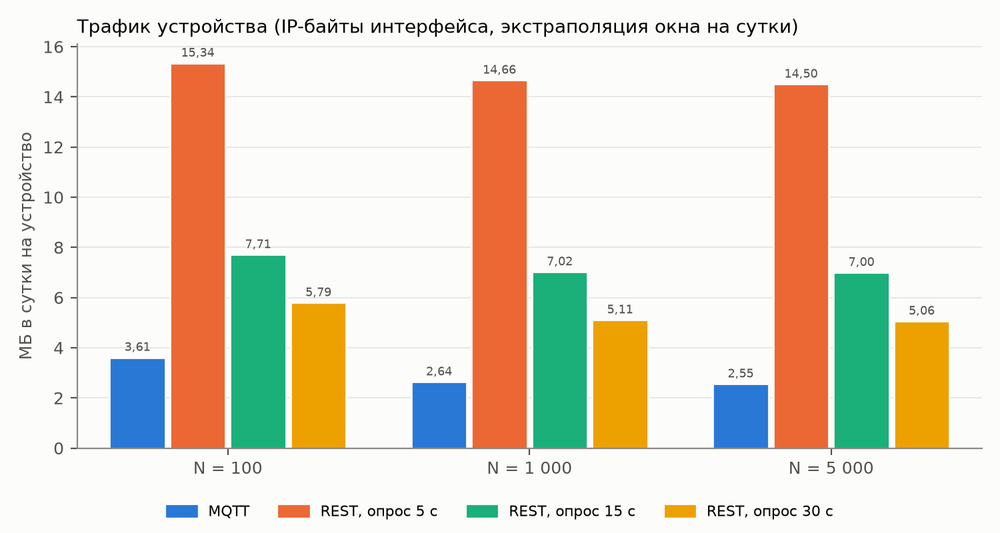
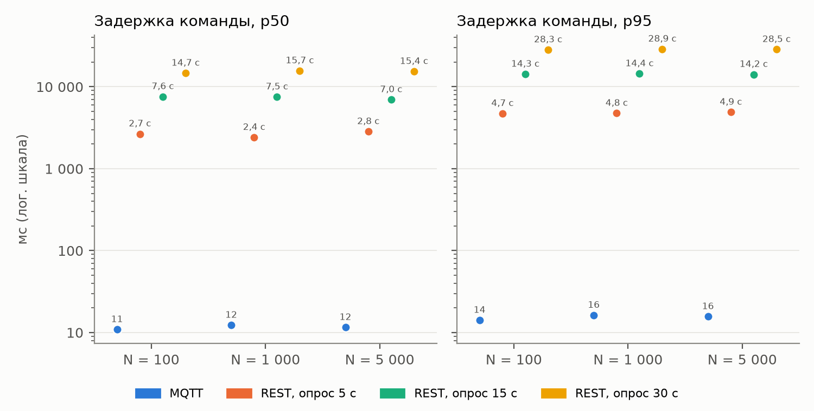
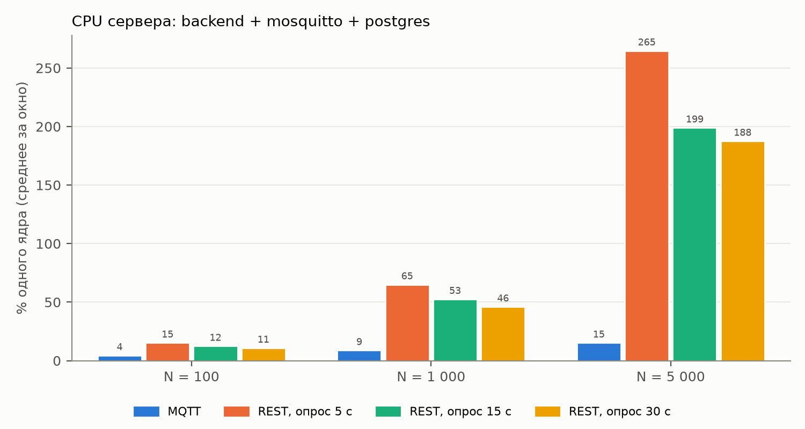
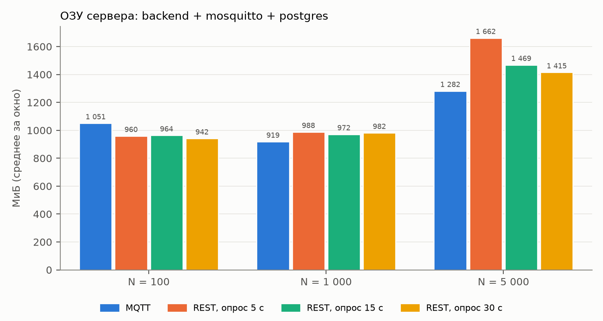
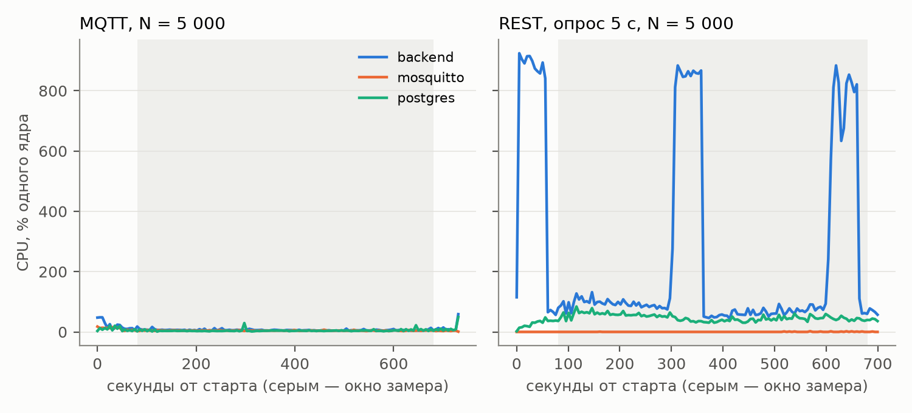
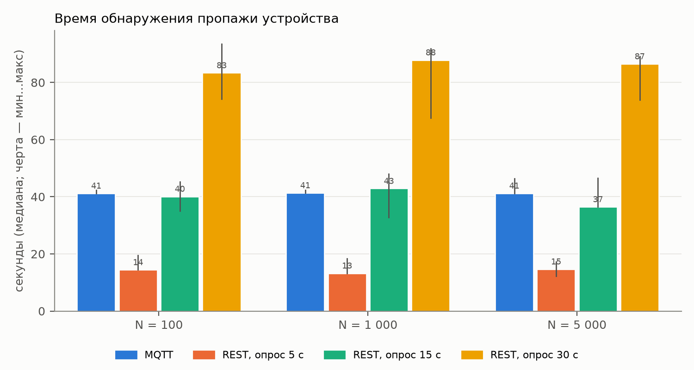
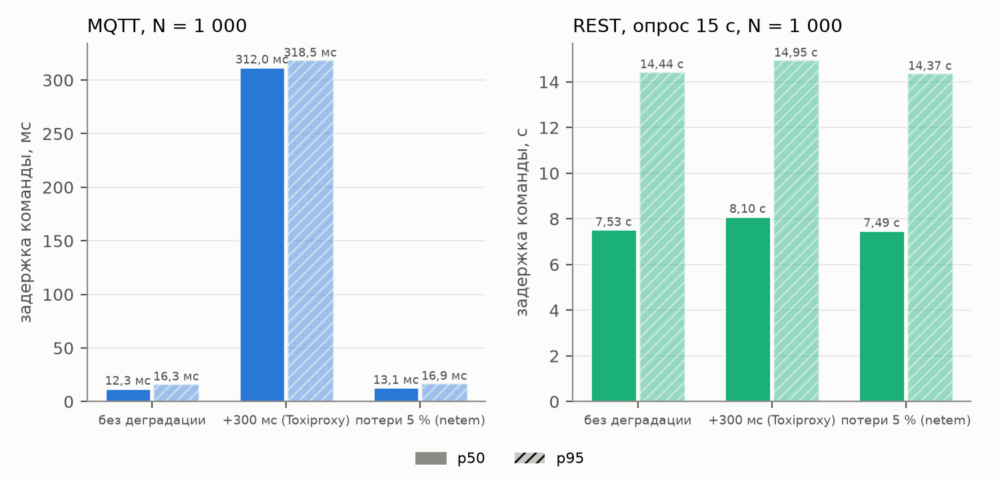

# Эксперимент «MQTT vs REST-polling» — результаты

> Сгенерировано `tools/experiments/analyze.py` из CSV прогонов (`docs/experiments/data/`). Числа в этом файле не правятся руками: изменились CSV — перезапустить скрипт. Методика и решения — `docs/reports/1-coursework/K4.md`, `decisions.md` (реш. 279–291; ревью КМ5 — 309, 310; серия 2 — 314–317).

## Условия

- **Машина:** Apple M1 Pro, cpus 10, mem 16 GiB; Docker Desktop 29.2.0, VM cpus 10, mem 8217382912. Сервер (backend, mosquitto, postgres) и симулятор — на одной машине, в одной виртуальной машине Docker.
- **Симулятор:** контейнер `simulator` (compose, profile `experiment`), ограничения cpus 2, mem 3g, heap 2g; один процесс JVM, клиенты HiveMQ на общем event loop (MQTT) или OkHttp с отдельным keep-alive соединением на устройство (REST).
- **Прогоны:** 16, с 2026-11-11T20:56:48Z по 2026-11-12T00:06:11Z (UTC). Каждый прогон: разгон 100 подключений/с, прогрев 30 с, **окно замера 600 с**, затем добор команд и замер пропажи. Телеметрия раз в 30 с (MQTT — из тени, REST — из сценария), команды `ping` 60 в минуту случайным устройствам (600 за окно). Вход измерителя (admin) — в фазе прогрева, до окна (реш. 309).
- **Трафик** — IP-байты интерфейса устройств в контейнере симулятора (`/sys/class/net/*/statistics`), то есть вместе с заголовками TCP/IP, TLS (MQTT), keep-alive и ACK; измеритель ходит к бэкенду через отдельную сеть и в счётчик не попадает. «В сутки» — линейная экстраполяция окна 600 с (реш. 209).
- **Задержка команды** — от момента перед `POST /devices/{id}/commands` до получения команды устройством (MQTT — колбэк HiveMQ, REST — ответ опроса), обе отметки — монотонные часы одного процесса; перцентили — ближайший ранг.
- **CPU/ОЗУ сервера** — `docker stats --no-stream` раз в 5 с (`docker-stats.csv`); CPU — проценты одного ядра, сумма трёх контейнеров по сэмплу: среднее, медиана и пик (максимум) по сэмплам окна.
- **Пропажа** — 10 последних устройств прогона замолкают без DISCONNECT и без закрытия TCP; `GET /devices/{id}` раз в секунду до `offline`. MQTT — LWT брокера по keep-alive (30 с × 1,5), REST — планировщик бэкенда (нет опроса дольше 3 × интервал опроса, проверка раз в 5 с, реш. 214).

## 1. Трафик на устройство

МБ в сутки на устройство (приём + передача), экстраполяция окна 600 с; в скобках — доля передачи устройства.

| Режим | N = 100 | N = 1 000 | N = 5 000 |
|---|---|---|---|
| MQTT | 3,61 (69 %) | 2,64 (74 %) | 2,55 (75 %) |
| REST, опрос 5 с | 15,34 (65 %) | 14,66 (65 %) | 14,50 (65 %) |
| REST, опрос 15 с | 7,71 (70 %) | 7,02 (70 %) | 7,00 (69 %) |
| REST, опрос 30 с | 5,79 (72 %) | 5,11 (73 %) | 5,06 (73 %) |

N = 1 000: полезная нагрузка приложения (JSON сообщений и тел HTTP) против IP-байтов интерфейса и NET I/O контейнера по `docker stats` (сверка; включает и трафик измерителя), МБ/сутки на устройство:

| Режим | полезная нагрузка | IP-байты интерфейса | docker stats NET I/O |
|---|---|---|---|
| MQTT | 1,10 | 2,64 | 2,76 |
| REST, опрос 5 с | 1,43 | 14,66 | 14,75 |
| REST, опрос 15 с | 1,25 | 7,02 | 7,12 |
| REST, опрос 30 с | 1,21 | 5,11 | 5,20 |

## 2. Задержка доставки команды

p50 / p95 / максимум; «доставлено» — получено устройством из отправленных.

| Режим | N | p50 | p95 | макс. | доставлено | `succeeded` |
|---|---|---|---|---|---|---|
| MQTT | 100 | 10,9 мс | 14,1 мс | 18,1 мс | 600/600 | 600/600 |
| MQTT | 1 000 | 12,3 мс | 16,3 мс | 35,3 мс | 600/600 | 600/600 |
| MQTT | 5 000 | 11,6 мс | 15,7 мс | 37,9 мс | 600/600 | 600/600 |
| REST, опрос 5 с | 100 | 2,66 с | 4,72 с | 5,22 с | 600/600 | 600/600 |
| REST, опрос 5 с | 1 000 | 2,41 с | 4,75 с | 5,19 с | 600/600 | 600/600 |
| REST, опрос 5 с | 5 000 | 2,84 с | 4,89 с | 7,84 с | 600/600 | 600/600 |
| REST, опрос 15 с | 100 | 7,59 с | 14,26 с | 15,23 с | 600/600 | 600/600 |
| REST, опрос 15 с | 1 000 | 7,53 с | 14,44 с | 15,64 с | 600/600 | 600/600 |
| REST, опрос 15 с | 5 000 | 6,96 с | 14,16 с | 15,30 с | 600/600 | 600/600 |
| REST, опрос 30 с | 100 | 14,67 с | 28,29 с | 31,11 с | 600/600 | 600/600 |
| REST, опрос 30 с | 1 000 | 15,70 с | 28,87 с | 31,05 с | 600/600 | 600/600 |
| REST, опрос 30 с | 5 000 | 15,38 с | 28,54 с | 30,76 с | 600/600 | 600/600 |

## 3. Нагрузка на сервер

Среднее за окно: CPU — % одного ядра, ОЗУ — МиБ; поток — сообщений/с (MQTT, в обе стороны) или успешных запросов/с (REST). Для суммы CPU трёх контейнеров — среднее, медиана и пик по сэмплам окна (раз в 5 с).

Окно 600 с — 2 TTL кэша Basic (300 с, реш. 213, 310). REST-устройство проходит полную проверку bcrypt при первом запросе и затем раз в TTL плюс ожидание следующего запроса, поэтому в окно, кратное TTL, попадает одинаковое число повторных проверок (≈ 2 на устройство) при любой фазе окна. **Среднее за окно — стационарная оценка нагрузки**: она включает периодическую проверку bcrypt в той доле, которая была бы и в сутках работы. Медиана — «фон» между проверками, пик — высота всплеска: после массового подключения проверки синхронны, и у REST при больших N всплески видны на графике CPU во времени. У MQTT пароль проверяется только при подключении (до окна).

| Режим | N | backend CPU / ОЗУ | mosquitto CPU / ОЗУ | postgres CPU / ОЗУ | CPU сумма: среднее / медиана / пик | поток, 1/с | CPU симулятора |
|---|---|---|---|---|---|---|---|
| MQTT | 100 | 2,1 / 513 | 0,4 / 33 | 1,9 / 504 | 4,4 / 4,3 / 8,6 | 6,3 | 3 |
| MQTT | 1 000 | 4,8 / 431 | 1,6 / 59 | 2,4 / 429 | 8,8 / 8,2 / 23,4 | 36,3 | 5 |
| MQTT | 5 000 | 6,4 / 419 | 4,4 / 222 | 4,4 / 642 | 15,2 / 14,4 / 38,2 | 169,6 | 12 |
| REST, опрос 5 с | 100 | 11,2 / 425 | 0,1 / 32 | 4,0 / 503 | 15,2 / 12,6 / 122,8 | 24,3 | 3 |
| REST, опрос 5 с | 1 000 | 48,6 / 499 | 0,5 / 31 | 15,9 / 458 | 65,0 / 40,3 / 734,3 | 234,2 | 9 |
| REST, опрос 5 с | 5 000 | 216,7 / 596 | 0,2 / 109 | 47,8 / 957 | 264,8 / 141,6 / 923,5 | 1 140,8 | 40 |
| REST, опрос 15 с | 100 | 9,7 / 429 | 0,3 / 32 | 2,4 / 503 | 12,4 / 9,2 / 70,6 | 11,0 | 3 |
| REST, опрос 15 с | 1 000 | 42,1 / 468 | 0,2 / 31 | 10,2 / 473 | 52,5 / 27,7 / 456,4 | 100,9 | 6 |
| REST, опрос 15 с | 5 000 | 174,7 / 504 | 0,1 / 110 | 24,2 / 855 | 198,9 / 64,5 / 938,7 | 500,1 | 20 |
| REST, опрос 30 с | 100 | 8,5 / 404 | 0,4 / 32 | 1,9 / 507 | 10,8 / 7,8 / 74,0 | 7,6 | 2 |
| REST, опрос 30 с | 1 000 | 37,5 / 460 | 0,1 / 31 | 8,4 / 490 | 46,0 / 24,6 / 354,3 | 67,6 | 6 |
| REST, опрос 30 с | 5 000 | 165,1 / 543 | 0,2 / 109 | 22,3 / 763 | 187,6 / 52,1 / 944,3 | 334,2 | 15 |

## 4. Время обнаружения пропажи

Медиана (мин…макс), секунды; обнаружено — из 10.

| Режим | N = 100 | N = 1 000 | N = 5 000 |
|---|---|---|---|
| MQTT | 41,2 (41,2…42,3), 10/10 | 41,4 (41,4…42,4), 10/10 | 41,3 (41,2…46,3), 10/10 |
| REST, опрос 5 с | 14,5 (14,5…19,5), 10/10 | 13,3 (13,3…18,3), 10/10 | 14,7 (12,2…17,2), 10/10 |
| REST, опрос 15 с | 40,1 (35,0…45,2), 10/10 | 42,9 (32,7…47,9), 10/10 | 36,5 (36,5…46,6), 10/10 |
| REST, опрос 30 с | 83,4 (74,1…93,5), 10/10 | 87,9 (67,5…91,9), 10/10 | 86,5 (73,9…89,0), 10/10 |

## 5. Деградация сети, N = 1 000

Toxiproxy: +300 мс на каждый ответ сервера (latency, downstream) перед брокером (`mqtt`) и бэкендом (`rest`); потери: `tc netem loss 5%` на исходящем интерфейсе устройств в контейнере симулятора.

| Режим | Сеть | p50 | p95 | доставлено | МБ/сутки | обрывов | ошибок отправки | CPU сервера |
|---|---|---|---|---|---|---|---|---|
| MQTT | без деградации | 12,3 мс | 16,3 мс | 600/600 | 2,64 | 0 | 0 | 8,8 |
| MQTT | +300 мс (Toxiproxy) | 312,0 мс | 318,5 мс | 600/600 | 3,01 | 0 | 0 | 8,5 |
| MQTT | потери 5 % (netem) | 13,1 мс | 16,9 мс | 600/600 | 2,65 | 0 | 0 | 8,9 |
| REST, опрос 15 с | без деградации | 7,53 с | 14,44 с | 600/600 | 7,02 | 0 | 0 | 52,5 |
| REST, опрос 15 с | +300 мс (Toxiproxy) | 8,10 с | 14,95 с | 600/600 | 7,59 | 0 | 0 | 51,1 |
| REST, опрос 15 с | потери 5 % (netem) | 7,49 с | 14,37 с | 600/600 | 7,13 | 0 | 0 | 52,4 |

## Выводы

- **Трафик, N = 100:** MQTT 3,61 МБ/сутки на устройство; REST 30 с — в 1,6 раза больше, REST 15 с — в 2,1 раза больше, REST 5 с — в 4,2 раза больше.
- **Трафик, N = 1 000:** MQTT 2,64 МБ/сутки на устройство; REST 30 с — в 1,9 раза больше, REST 15 с — в 2,7 раза больше, REST 5 с — в 5,6 раза больше.
- **Трафик, N = 5 000:** MQTT 2,55 МБ/сутки на устройство; REST 30 с — в 2,0 раза больше, REST 15 с — в 2,7 раза больше, REST 5 с — в 5,7 раза больше.
- **Задержка команды, N = 100:** MQTT p50 10,9 мс, p95 14,1 мс, макс. 18,1 мс; REST p50 2,66 с / 7,59 с / 14,67 с при опросе 5 / 15 / 30 с (0,49…0,53 интервала) — задержку REST задаёт интервал опроса, а не сервер.
- **Задержка команды, N = 1 000:** MQTT p50 12,3 мс, p95 16,3 мс, макс. 35,3 мс; REST p50 2,41 с / 7,53 с / 15,70 с при опросе 5 / 15 / 30 с (0,48…0,52 интервала) — задержку REST задаёт интервал опроса, а не сервер.
- **Задержка команды, N = 5 000:** MQTT p50 11,6 мс, p95 15,7 мс, макс. 37,9 мс; REST p50 2,84 с / 6,96 с / 15,38 с при опросе 5 / 15 / 30 с (0,46…0,57 интервала) — задержку REST задаёт интервал опроса, а не сервер.
- **CPU сервера, N = 100** (% одного ядра): среднее за окно MQTT 4,4, REST 30 / 15 / 5 с — 10,8 / 12,4 / 15,2 (в 2,5 / 2,8 / 3,5 раза больше MQTT); медиана MQTT 4,3, REST 7,8 / 9,2 / 12,6; пик MQTT 9, REST 74 / 71 / 123.
- **CPU сервера, N = 1 000** (% одного ядра): среднее за окно MQTT 8,8, REST 30 / 15 / 5 с — 46,0 / 52,5 / 65,0 (в 5,2 / 6,0 / 7,4 раза больше MQTT); медиана MQTT 8,2, REST 24,6 / 27,7 / 40,3; пик MQTT 23, REST 354 / 456 / 734.
- **CPU сервера, N = 5 000** (% одного ядра): среднее за окно MQTT 15,2, REST 30 / 15 / 5 с — 187,6 / 198,9 / 264,8 (в 12,3 / 13,1 / 17,4 раза больше MQTT); медиана MQTT 14,4, REST 52,1 / 64,5 / 141,6; пик MQTT 38, REST 944 / 939 / 923.
- **REST 5 с, N = 5 000: команды дольше интервала опроса** — 13 из 600 дольше 1,1 интервала (макс. 7,84 с), из них 13 — во время всплеска CPU сервера (сэмпл выше 3 медиан окна): под всплеском bcrypt запись команды и ответы опроса задерживаются.
- **Вклад всплесков bcrypt** (оценка: среднее − медиана CPU, % ядра) у REST 30 / 15 / 5 с: N = 100 — 3,1 / 3,3 / 2,7; N = 1 000 — 21,4 / 24,9 / 24,7; N = 5 000 — 135,5 / 134,5 / 123,1. От интервала опроса он почти не зависит и растёт с N: повторная проверка идёт раз в TTL на устройство при любом опросе, поэтому при больших N средний CPU REST определяют проверки пароля, а не частота опроса; частоту опроса видно по медиане.
- **Рост CPU сервера с N** (среднее, N = 100 → 1 000 → 5 000): MQTT 4,4 → 8,8 → 15,2 (× 3,4); REST, опрос 5 с 15,2 → 65,0 → 264,8 (× 17,4); REST, опрос 15 с 12,4 → 52,5 → 198,9 (× 16,0); REST, опрос 30 с 10,8 → 46,0 → 187,6 (× 17,3).
- **Обнаружение пропажи, N = 1 000:** MQTT 41,4 с (keep-alive 30 с, предел 1,5 × keep-alive); REST 5 с — 13,3 с, REST 15 с — 42,9 с, REST 30 с — 87,9 с (2,7…2,9 интервала опроса): у REST время задаётся порогом 3 × интервал опроса — короче оно только ценой частого опроса и трафика.
- **MQTT, +300 мс (Toxiproxy):** p50 12,3 мс → 312,0 мс, p95 16,3 мс → 318,5 мс, доставлено 600/600, обрывов соединений 0.
- **MQTT, потери 5 % (netem):** p50 12,3 мс → 13,1 мс, p95 16,3 мс → 16,9 мс, доставлено 600/600, обрывов соединений 0.
- **REST 15 с, +300 мс (Toxiproxy):** p50 7,53 с → 8,10 с, p95 14,44 с → 14,95 с, доставлено 600/600, обрывов соединений 0.
- **REST 15 с, потери 5 % (netem):** p50 7,53 с → 7,49 с, p95 14,44 с → 14,37 с, доставлено 600/600, обрывов соединений 0.

## Оговорки

- **Сокращённые прогоны** (реш. 209): окно 600 с вместо суток; «в сутки» — линейная экстраполяция. Суточные эффекты (переподключения, ротация сессий, рост БД) не измерены.
- **Одна машина:** сервер и симулятор делят CPU и сеть одной виртуальной машины Docker; сеть — мост Docker без реальной задержки. Абсолютные числа CPU — для этой машины; сравнимы между режимами, а не с продом.
- **REST без TLS:** устройства в REST-режиме ходят к бэкенду по HTTP (`backend:8080`, как задумано контрактом K2), MQTT — по TLS 8883. Сравнение консервативно в пользу REST: с HTTPS трафик и CPU REST были бы выше (реш. 282).
- **Задержка MQTT** включает вызов REST API бэкенда (запись команды в БД + публикация), а не только доставку брокером; задержка REST — в основном ожидание следующего опроса (≈ половина интервала в среднем).
- **Пропажа MQTT** считается от момента замолкания: брокер разрывает соединение через 1,5 × keep-alive (45 с) от последнего пакета устройства (плюс шаг опроса статуса 1 с), поэтому от момента пропажи время бывает и меньше 45 с. Mosquitto 2.1 проверяет keep-alive пачками: по журналу брокера (`raw/<прогон>/keepalive-timeouts.csv`, точность 1 с) в одну секунду отключены «exceeded timeout» 10 из 10 пропавших при N = 100; 9 из 10 пропавших при N = 1 000; 7 из 10 пропавших при N = 5 000, хотя последний пакет у них был в разное время (фаза телеметрии случайна), — отсюда разный разброс по прогонам: N = 100 — 41,2…42,3 с; N = 1 000 — 41,4…42,4 с; N = 5 000 — 41,2…46,3 с.
- **Потери 5 %** — только на исходящем трафике устройств (`netem` на egress, реш. 291: `ifb` для входящего направления в ядре Docker Desktop нет); входящие пакеты не теряются, но потеря ACK устройства вызывает повторы и со стороны сервера. Влияние потерь на задержку команды (сервер → устройство) поэтому занижено.
- **Деградация** проверена только на N = 1 000 и REST 15 с (реш. 284); +300 мс — на ответ сервера (RTT +300 мс).
- **Заголовки `X-RateLimit-*` у REST** (ревью КМ5, R-7, реш. 306, 317): маршруты опроса обёрнуты в плагин RateLimit Ktor (лимит неудачных Basic), и он добавляет к каждому ответу `X-RateLimit-Limit`, `-Remaining`, `-Reset` (81 Б). Приём устройства на запрос против серии 1 вырос на 81…90 Б, трафик REST на устройство — на 10…13 %, у MQTT изменился на -0,2…0,1 %. Числа выше — для бэкенда как он есть; без этих заголовков трафик REST был бы ближе к серии 1, отношения REST/MQTT — чуть меньше.
- **Команды измерителя** (60 в минуту на весь парк, реш. 287) входят в трафик устройств: на устройство их тем больше, чем меньше N, поэтому трафик на устройство сравним между режимами при одном N, а между N — с этой поправкой (при N = 100 команд на устройство в 10 раз больше, чем при N = 1 000).
- **Бэкенд пересоздаётся** перед прогоном, если меняется порог presence REST (реш. 289): JIT и кэш Basic прогреваются в фазе разгона и прогрева, до окна. Кэш Basic живёт 5 мин от успешной проверки (реш. 213), одинаково для всех устройств: после массового подключения REST-парка повторные проверки bcrypt идут синхронным всплеском раз в ≈ 5 мин (разброс TTL — этап П, `K5.md`). На реальном парке подключения размазаны во времени, и пик был бы ниже, а среднее — тем же.
- **REST-доставка команды — «не больше одного раза»** (ревью КМ5, R-9, реш. 312): `GET /poll/commands` переводит команду в `delivered` в той же транзакции, в которой выдаёт её, — до того как ответ дошёл до устройства. Обрыв после commit оставляет команду `delivered`: повторно она не выдаётся и истекает. MQTT (QoS 1, постоянная сессия) доставляет «хотя бы один раз». В прогонах потерь не было, но сравнение надёжности протоколов опирается на эту асимметрию.
- **Окно 600 с — 2 TTL кэша Basic** (реш. 310): среднее CPU REST включает стационарную долю повторных проверок bcrypt; вход измерителя — в фазе прогрева, до окна (реш. 309), поэтому «макс.» задержки — тоже по командам окна.

## Серия 1 (отменена)

Первая серия (КМ4, 11.11.2026, окно 240 с) отменена ревью КМ5 (`docs/reports/1-coursework/review.md`):

- **R-4** — первая команда каждого прогона включала вход измерителя (`/auth/login`, bcrypt): «макс.» и среднее задержки MQTT были завышены одной выборкой.
- **R-5** — окно 240 с было короче TTL кэша Basic (300 с): при N ≤ 1 000 в окно не попадала ни одна повторная проверка bcrypt (CPU REST занижен), при N = 5 000 в конец окна попадал синхронный всплеск истечения кэша (CPU REST завышен); вывод «CPU REST 5 с в 10,1 раза больше MQTT при N = 5 000» держался на этом всплеске.

Что изменилось в серии 2: вход измерителя — в фазе прогрева (реш. 309); окно 600 с во всех 16 прогонах (реш. 310), команд за окно 600 вместо 240; бэкенд и брокер — с исправлениями раунда 5.3 (`dd9e211`: переподписка на каждом подключении, пределы пакета и очередей брокера, лимит неудачных Basic, перепроверка статуса после записи в кэш Basic; ответы опроса — с заголовками `X-RateLimit-*`, см. оговорки). Порядок прогонов, сценарии (кроме окна), машина и ресурсы — те же; между прогонами — пауза 30 с, сбойный прогон повторяется один раз (реш. 314). Сводка серии 1 — `data/runs-series1-240s.csv`, сырьё — `data/raw/` в истории git (коммит `551ed0d`) и `logs/experiments-series1-240s/` (вне git).

Серия 1 → серия 2 (окно 240 с → 600 с):

| Прогон | МБ/сутки | p50 | макс. задержки | CPU сервера, среднее | CPU, медиана | обнаружение, с |
|---|---|---|---|---|---|---|
| `mqtt-100` | 3,61 → 3,61 | 12,1 мс → 10,9 мс | 140,3 мс → 18,1 мс | 4,6 → 4,4 | 4,2 → 4,3 | 43,4 → 41,2 |
| `rest5-100` | 13,61 → 15,34 | 2,91 с → 2,66 с | 5,21 с → 5,22 с | 14,6 → 15,2 | 13,2 → 12,6 | 18,5 → 14,5 |
| `rest15-100` | 6,89 → 7,71 | 7,33 с → 7,59 с | 15,27 с → 15,23 с | 10,0 → 12,4 | 9,3 → 9,2 | 42,2 → 40,1 |
| `rest30-100` | 5,20 → 5,79 | 16,02 с → 14,67 с | 31,14 с → 31,11 с | 9,1 → 10,8 | 8,9 → 7,8 | 85,6 → 83,4 |
| `mqtt-1000` | 2,64 → 2,64 | 11,2 мс → 12,3 мс | 221,1 мс → 35,3 мс | 9,2 → 8,8 | 8,7 → 8,2 | 31,1 → 41,4 |
| `rest5-1000` | 12,99 → 14,66 | 2,29 с → 2,41 с | 5,08 с → 5,19 с | 37,0 → 65,0 | 36,2 → 40,3 | 16,3 → 13,3 |
| `rest15-1000` | 6,28 → 7,02 | 7,27 с → 7,53 с | 15,67 с → 15,64 с | 26,1 → 52,5 | 25,6 → 27,7 | 44,7 → 42,9 |
| `rest30-1000` | 4,60 → 5,11 | 16,88 с → 15,70 с | 31,06 с → 31,05 с | 25,6 → 46,0 | 24,3 → 24,6 | 83,4 → 87,9 |
| `mqtt-5000` | 2,56 → 2,55 | 12,0 мс → 11,6 мс | 216,9 мс → 37,9 мс | 15,5 → 15,2 | 14,4 → 14,4 | 44,5 → 41,3 |
| `rest5-5000` | 12,99 → 14,50 | 2,57 с → 2,84 с | 5,12 с → 7,84 с | 156,5 → 264,8 | 100,1 → 141,6 | 15,8 → 14,7 |
| `rest15-5000` | 6,23 → 7,00 | 6,68 с → 6,96 с | 15,04 с → 15,30 с | 96,7 → 198,9 | 59,1 → 64,5 | 40,2 → 36,5 |
| `rest30-5000` | 4,55 → 5,06 | 16,21 с → 15,38 с | 30,97 с → 30,76 с | 67,8 → 187,6 | 49,2 → 52,1 | 84,1 → 86,5 |
| `mqtt-1000-lat300` | 3,01 → 3,01 | 312,6 мс → 312,0 мс | 473,2 мс → 329,0 мс | 8,6 → 8,5 | 8,1 → 7,9 | 32,5 → 36,4 |
| `mqtt-1000-loss5` | 2,65 → 2,65 | 13,7 мс → 13,1 мс | 211,1 мс → 107,3 мс | 10,2 → 8,9 | 9,6 → 8,5 | 43,6 → 41,4 |
| `rest15-1000-lat300` | 6,90 → 7,59 | 8,08 с → 8,10 с | 16,22 с → 16,24 с | 23,9 → 51,1 | 22,3 → 26,6 | 40,1 → 39,8 |
| `rest15-1000-loss5` | 6,35 → 7,13 | 7,07 с → 7,49 с | 15,68 с → 15,67 с | 28,9 → 52,4 | 27,8 → 27,5 | 44,7 → 40,8 |
