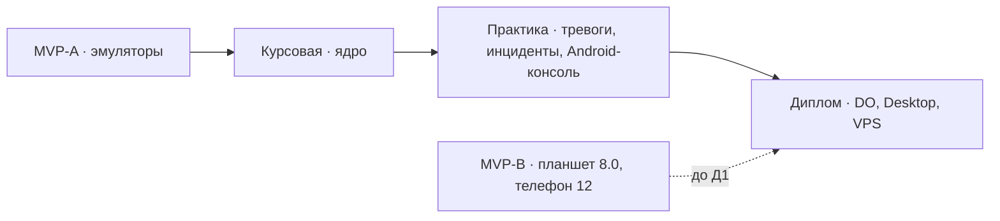

# RestoFleet — дорожная карта

**Дата:** 05.11.2026. Общая архитектура — [architecture.md](architecture.md). Каждый этап описан в отдельном самодостаточном файле: его можно вести **отдельной сессией**.

**Время:** ≈ 5 календарных месяцев, из них ≈ 9–10 активных недель с вайбкодингом. Календарь привязывается к учебному графику.

| Этап | Файл | Активных недель | Суть | Блокирует |
|---|---|---|---|---|
| **MVP-A** | [stages/0-mvp.md](stages/0-mvp.md) · чек-лист [0-mvp-feasibility.md](stages/0-mvp-feasibility.md) | 1,5 | Все считывания агента, Device Owner, MQTT-цепочка, спайки сервера — на эмуляторах | курсовую |
| **MVP-B** | там же, задача M5 | 1–2 дня | Планшет Android 8.0 (DO), телефон Android 12 — когда появятся | Д1 |
| **К** | [stages/1-coursework.md](stages/1-coursework.md) | 3 | Ядро: протокол MQTT + агент + брокер + ядро бэкенда + симулятор + эксперимент | практику |
| **П** | [stages/2-practice.md](stages/2-practice.md) | 2 | Тревоги, корреляция инцидентов, Android-консоль, анализ в компании | диплом |
| **Д** | [stages/3-diploma.md](stages/3-diploma.md) | 3 | Device Owner, безопасность, профили, Desktop-консоль (с ресторанами), 10 000, VPS | — |

## Как вести этап отдельной сессией

1. Начать сессию в корне репозитория — `CLAUDE.md` подгрузится сам.
2. Сказать: «Работаем над этапом <MVP | курсовая | практика | диплом>». Сессия читает `docs/architecture.md` и файл этапа (в шапке каждого файла указано, какие разделы нужны).
3. Перед кодом — детальный пошаговый план этапа (задачи по 2–5 мин, TDD) в `docs/superpowers/plans/`. Если этап уже начат — сначала прочитать `docs/handoff.md`.
4. В конце этапа обновить раздел «Передаётся дальше» файла этапа фактическим состоянием и отметить задачи `[x]`.

## Правила для всех этапов

- Clean Architecture, TDD, Kover-гейт (проект ≥ 80 %, domain ≥ 90 %).
- Koin везде, включая бэкенд; без convention-плагинов — `build.gradle.kts` + `libs.versions.toml`.
- Каждый этап заканчивается демонстрируемым результатом и зелёным CI.
- Требования, получившие ❌ в MVP, не реализуются ни на одном этапе.
- **Git — ветка на этап:** `main` хранит документацию и завершённые этапы; MVP — `stage/0-mvp`, курсовая — `stage/1-coursework`, практика — `stage/2-practice`, диплом — `stage/3-diploma`. Ветка этапа создаётся от `main` после слияния предыдущего; слияние — `--no-ff` с тегом (`mvp-a`, `mvp-b`, `coursework`, `practice`, `diploma`).
- **Отчётность и handoff:** `docs/handoff.md` — точка входа для любой сессии и агента (текущее состояние + журнал), обновляется после каждой задачи; отчёты вех — `docs/reports/<этап>/M<k>.md`, журнал решений — `docs/reports/<этап>/decisions.md`. Отчёты — сырьё для текстов курсовой, практики и диплома.
- Unit-тесты — JUnit 4 + Google Truth.
