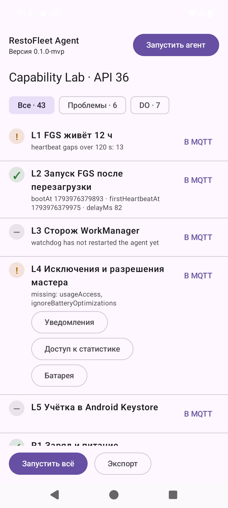
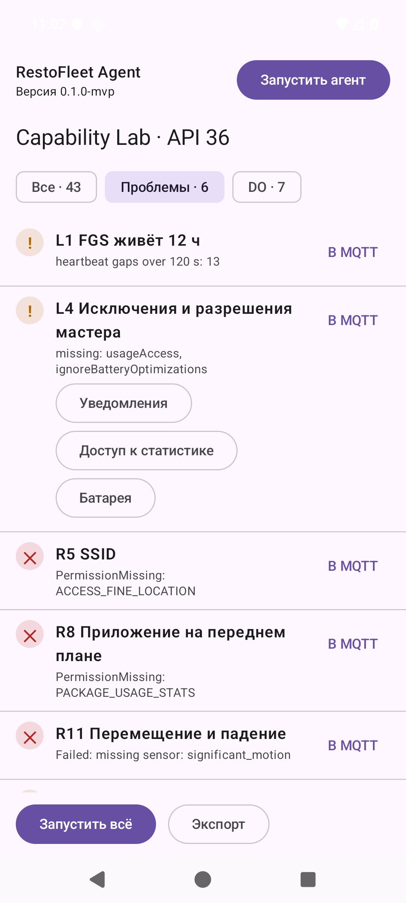
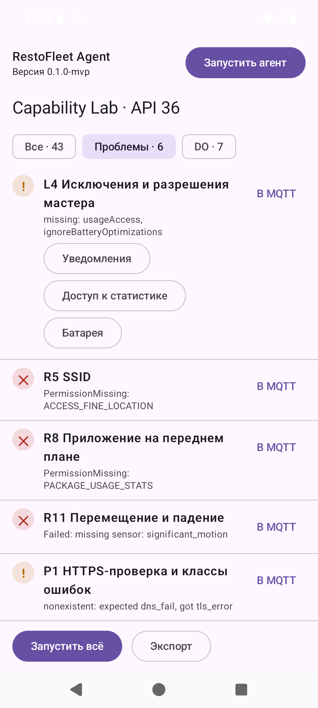

# Отчёт вехи M1 — агент: все считывания

**Этап:** MVP-A · **Ветка:** `stage/0-mvp` · **Даты:** 06–07.11.2026 · **План:** `docs/superpowers/plans/2026-11-05-mvp-a.md`, задачи 1.1–1.10 · **Диапазон коммитов:** `5379cba..008162b` (затем коммит этой задачи)

## Цель вехи

Сделать Android-агент, который умеет считывать все показатели из матрицы возможностей и показывает результат на экране Capability Lab:
- модуль `console:core:mvi` с каноном MVI (по `white-label-android`);
- `agent:domain` — модель считываний, `CollectTelemetry`, каталог из 43 проверок, `RunCapabilityChecks`, `ExportCapabilityReport`;
- `agent:data` — коллекторы R1–R9, R11, R12, R14, HTTPS-пробы P1–P3, журналы жизненного цикла, JSON-отчёт;
- `agent:app` — FGS `specialUse`, автозапуск, сторож WorkManager, Koin;
- `agent:presentation` — Capability Lab (MVI) с запуском проверок и экспортом отчёта.

## Что сделано

| Задача | Результат | Ключевые файлы |
|---|---|---|
| 1.1 | `console:core:mvi` (KMP: Android + JVM): контракты `MviIntent/Action/State/Effect`, `Reducer`, `MviStore`, `BaseMviViewModel` (`InstanceKeeper.Instance`, эффекты через `Channel`) | `console/core/mvi/src/commonMain/.../{MviStore,Reducer,BaseMviViewModel}.kt` |
| 1.2 | `agent:domain`: модель (`Reading`, `UnavailableReason`, `BatteryState`, `Thermal`, `Network`, `DeviceResources`, `ForegroundApp`, `TelemetrySnapshot`) и порты `TelemetrySource`, `SequenceSource` | `agent/domain/.../model/*.kt`, `port/*.kt` |
| 1.3 | `CollectTelemetry`: каждое считывание изолировано, сбой превращается в `Unavailable(Failed(...))` | `agent/domain/.../usecase/CollectTelemetry.kt` |
| 1.4 | Каталог из 43 `CheckId`, `CheckStatus`, `CapabilityCheck`, `RunCapabilityChecks` (таймаут на проверку), `ExportCapabilityReport` | `agent/domain/.../capability/*.kt`, `usecase/*.kt` |
| 1.5 | Первый Android-модуль `agent:data`: чистые функции маппинга Android → domain (батарея, термальный статус, сеть, ресурсы, приложение на экране, падение, пропуски heartbeat); отдельный Kover-гейт «ветви платформенного пакета 100 %» | `agent/data/.../platform/*.kt` |
| 1.6 | Коллекторы R1–R9, R11, R12, R14, `ReadingCheck`, `SubscriptionCheck`, `CapabilityChecksFactory` | `agent/data/.../collectors/*.kt` |
| 1.7 | HTTPS-пробы на OkHttp (классы ошибок, фазы соединения), проба шлюза, проверки P1–P3 | `agent/data/.../probes/*.kt`, `agent/domain/.../model/Probe.kt` |
| 1.8 | `agent:app`: FGS `specialUse`, `BootReceiver`, `WatchdogWorker` (15 мин), журнал жизненного цикла, `HeartbeatLog`, проверки L1–L4, Koin | `agent/app/src/main/...`, `agent/data/.../lifecycle/*.kt` |
| 1.9 | `agent:presentation`: Capability Lab (MVI), JSON-экспорт отчёта, порт `CheckResultPublisher` (в M1 — заглушка «MQTT не настроен»); P1 переведена на параллельный запуск целей | `agent/presentation/.../lab/**`, `agent/data/.../report/JsonCapabilityReportWriter.kt` |
| Исправления по итоговому ревью вехи | 7 Important (I1–I7), перенесённые Minor, два раунда (решения 78–88) | см. раздел «Итоговое ревью вехи» |
| 1.10 | Этот отчёт, пересъёмка скриншотов и JSON Lab, обновление документов этапа и handoff | `docs/reports/0-mvp/M1.md`, `img/`, `capability/` |

## Решения

См. `decisions.md`: записи 26–47 — задачи 1.2–1.7, 48–77 — задачи 1.8–1.9, 78–88 — исправления по ревью вехи. Главные:
- **№ 27, 78:** `Error` не ловится (OOM не превращается в «все датчики Failed»); на границах изоляции `CancellationException` разбирается через `ensureActive()`: настоящая отмена идёт наружу, бродячая считается сбоем одного считывания.
- **№ 39:** `ConnectException` в Android оборачивает разные errno, поэтому классификатор разбирает текст всей цепочки причин по errno (`ECONNREFUSED`, `ETIMEDOUT`, `ENETUNREACH`, `EPERM/EACCES`); иначе P3 принимал бы недостижимый шлюз за достижимый.
- **№ 33:** `isEmulator` определяется по `Build.HARDWARE` (`ranchu`/`goldfish`) и префиксу fingerprint, а не по подстроке, как в плане: подстрока давала ложные срабатывания на реальных устройствах.
- **№ 61:** весь цикл телеметрии (запись `start`, тик, heartbeat) идёт на инжектируемом `CoroutineDispatcher` (в проде — IO), а не на Main.
- **№ 81, 88:** агент держит `PARTIAL_WAKE_LOCK` `RestoFleet:agent`, пока работает цикл; владелец замка — последний `Lease`. Цена по батарее записана как продуктовое решение и будет измерена в M4.
- **№ 83:** R8 (приложение на переднем плане) stateful: первый запрос — с момента загрузки, дальше с прошлого запроса минус 60 с; иначе приложение, которое весь час не уходит с экрана, давало `Unavailable`.
- **№ 84:** L3 = OK только после наблюдённого перезапуска сторожем; «запланирован, но ни разу не перезапускал» — `NOT_CHECKED`.

## Метрики

Команды: `./gradlew build koverHtmlReportCi koverXmlReportCi` (HEAD `008162b`, `BUILD SUCCESSFUL`, `rc=0`); число тестов — суммы атрибутов `tests/failures/errors/skipped` из `**/build/test-results/**/TEST-*.xml`; покрытие — из `reportCi.xml` каждого модуля и корня.

| Модуль | Тестов | Строки | Ветви | Инструкции |
|---|---|---|---|---|
| `console:core:mvi` | 10 | 100 % (21/21) | 100 % (4/4) | 100 % |
| `agent:domain` | 49 | 97,4 % (187/192) | 83,3 % (35/42) | 97,0 % |
| `agent:data` | 297 | 97,4 % (851/874) | 87,6 % (416/475) | 95,7 % |
| `agent:presentation` | 58 | 97,8 % (176/180) | 94,6 % (105/111) | 98,5 % |
| `agent:app` | 39 | 98,1 % (158/161) | 71,8 % (28/39) | 98,8 % |
| **M1, итого** | **453** | | | |
| `shared:kernel` / `shared:protocol` / `konsist-tests` (M0) | 15 / 22 / 5 | 100 % / 100 % | | |
| **Проект целиком (корневой агрегат)** | **495, 0 падений, 0 пропусков** | **97,0 % (1531/1579)** | 73,7 % (766/1039) | 93,3 % |

- Гейты: проект ≥ 80 %, `agent:*` ≥ 90 % по строкам; ветви платформенного пакета `agent:data` — 100 % (отдельный вариант Kover `platform`). Ветви в `agent:app` (71,8 %) и в корне (73,7 %) ниже строк: гейт идёт по строкам; в корне ветви тянут вниз сгенерированные сериализаторы `shared:protocol` (48,1 %), как отмечено в M0.
- Объём кода (`wc -l`, Kotlin; `cloc` не установлен): production — `agent:domain` 442, `agent:data` 2430, `agent:presentation` 774, `agent:app` 507, `console:core:mvi` 104, всего 4257 строк; тесты — 696, 3928, 813, 737, 187, всего 6361 строка.
- Время сборки: повторная полная `build koverHtmlReportCi koverXmlReportCi` — 5 с (486 задач, 29 выполнено, остальные up-to-date). Время сборки с нуля в M1 не замерялось (`./gradlew clean` не делался); в M0 было ≈ 1 мин. Самый долгий из сохранённых логов полных прогонов M1 с большим числом выполненных задач — 17 с (`task-1.9-full.log`, 73 задачи выполнено).
- Capability Lab на `rf-api36` (API 36, эмулятор, «Запустить всё» после исправлений), 43 записи в JSON: **ok — 12, limited — 3, unavailable — 3, not_checked — 25**.
  - `limited`: L1 (13 пропусков heartbeat длиннее 120 с; `wakeLock=held`), L4 (не выданы `usageAccess` и исключение из оптимизации батареи), P1 (`nonexistent: expected dns_fail, got tls_error`).
  - `unavailable`: R5 (`PermissionMissing: ACCESS_FINE_LOCATION`), R8 (`PermissionMissing: PACKAGE_USAGE_STATS`), R11 (`missing sensor: significant_motion`).
  - `not_checked` (25): L3, L5, R10, R13, P4, C1–C4, D1–D7, M1–M7, RS1–RS2. Для L3 это новое поведение (решение 84): в снимках задачи 1.9 L3 был ✅ без доказательства.
  - Для сравнения, снимок задачи 1.9 (до исправлений): ok 13, not_checked 24, limited 3, unavailable 3.
  - В JSON нет MAC, IMEI и серийного номера (`grep -ciE` — 0 совпадений).
- Wake lock: `adb shell dumpsys power | grep -i restofleet` → `PARTIAL_WAKE_LOCK 'RestoFleet:agent' ACQ=-6m4s600ms LONG (uid=10150 ...)`; `Wake Locks: size=1`.

## Ручная пересъёмка Lab (задача 1.10)

Это же — первая ручная проверка Lab после исправлений: в раунде исправлений Lab «Запустить всё» через UI не прогонялся. AVD `rf-api36`, `-no-window -no-audio -no-boot-anim -port 5600`, debug-APK поставлен поверх (`install -t -r`), нажатия через `uiautomator dump` и `input tap`.
- «Запустить всё» отработало до конца, все строки получили статусы; кнопки остались рабочими: после прогона «Экспорт» создал новый файл (9952 байта).
- «Экспорт», нажатый сразу после «Запустить всё», проигнорирован: файл отчёта на третьей секунде сохранял старое время изменения. Это косвенное доказательство (прямого наблюдения без таймстемпа не было).
- Foreground-сервис: `isForeground=true`, `types=0x40000000` (specialUse).
- L1 показывает 13 пропусков heartbeat; максимальный — 14 156 166 мс (≈ 3,9 ч). Между ручными проверками задачи 1.9, раунда исправлений и задачи 1.10 эмулятор останавливался (`emu kill`), а журнал heartbeat хранится на диске AVD. Поэтому пропуски, скорее всего, приходятся на периоды, когда устройство было выключено; по меткам загрузки это не сверялось. L1 сейчас не исключает интервалы, в которые попала перезагрузка, — доработка в M4.
- P1 `nonexistent.invalid` по-прежнему даёт `tls_error` за 1472 мс (см. «Что осталось»).
- `adb emu kill` выполнен, `adb devices` пуст.

## Как проверялось, что тесты что-то ловят

Мутационные проверки из отчётов задач и повторных ревью (мутация делалась временной правкой production-кода и откатом):

| Что сломали | Результат |
|---|---|
| 1.5: убрана строка `setOf(4) to NetworkType.OTHER` из теста сети | `koverVerifyPlatform` упал: ветви 98 % при пороге 100 % |
| 1.6: условие ожидания старта в `SubscriptionCheck.run()` → `if (false)` | упали `runRightAfterCreationWaitsForSubscriptionStart` и `subscriptionThatNeverStartsIsNotChecked` |
| 1.7: удалён `invokeOnCancellation` в `OkHttpProbeExecutor` | упал тест отмены |
| 1.7: удалён `socket.close()` в `GatewayProbe` | упал тест отмены |
| 1.9: P1 запускалась последовательно (проверка на виртуальном времени) | `p1ProbesTargetsConcurrentlyAndKeepsOrder`: 21 000 мс вместо 6 000 |
| Раунд 1, повторное ревью: убрана ветка `NOT_CHECKED` в `LifecycleChecks` | упали 3 теста L3 |
| убран `hold` на тике / в `AgentCycle.start` | упали `loopRenewsWakeLockOnEveryTick`, `loopReleasesWakeLockWhenItIsCancelled` / `cycleHoldsWakeLockFromStartAndReleasesItOnStop` |
| убран `release` в `stop()` | упал `cycleHoldsWakeLockFromStartAndReleasesItOnStop` (**не** эквивалентный мутант: без синхронного release замок держится до обработки отмены корутины; эквивалентным он ошибочно назван в отчёте исправлений) |
| `TelemetryLoop`: убран `ensureActive`; CE бросается всегда | упали `outerCancellationStopsTheLoop`, `outerCancellationDuringStrayCancellationStillStopsTheLoop` / `strayCancellationFromTickDoesNotKillTheLoop` |
| `CollectTelemetry`, `RunCapabilityChecks`, `P1Check`: CE бросается всегда | упали `strayCancellationFromReadingIsAFailureNotAnAbort`, `strayCancellationFromCheckDoesNotAbortTheRun`, `p1StrayCancellationIsUnavailableNotAnAbort` и парные |
| `CollectTelemetry`: убран `withTimeoutOrNull`; `AndroidTelemetrySource`: убран `runInterruptible` | упали `hangingReadingTimesOutAndOthersAreCollected`, `everyHangingReadingGetsItsOwnTimeout` / `everyBlockingReadingGoesThroughTheIoDispatcher` |
| `AgentService`: убраны catch отказов, `START_NOT_STICKY` → `START_STICKY`, убран `stopSelf` | упали 3, 2 и 2 теста соответственно |
| R8: `lastApp = null`; окно `now − 1 ч`; убран `previous` в резолвере | упали `secondReadWithoutNewEventsKeepsForegroundApp`, `switchingFromAToBAndStayingOnBKeepsB` / 4 теста, включая `appResumedTwoHoursAgoIsStillForeground` / по 2 теста коллектора и резолвера |
| Раунд 2: в `CollectTelemetry`, `RunCapabilityChecks`, `P1Check` убран `ensureActive()` (выживали после раунда 1) | упали `cancellationOfCallerInsideReadingStopsCollectionInInvokeItself`, `cancellationOfCallerInsideCheckStopsTheRunInInvokeItself`, `p1CancellationOfCallerInsideProbeIsRethrownByRunItself` |
| `LabViewModel.export` / `runAll`: `finally` заменён / убран | упали `errorFromExportResetsProgressAndIsNotSwallowed`, `errorFromCheckInRunAllResetsFlagsAndIsNotSwallowed` |
| R8: `lastQueryAt = null` вместо `now` | упал `secondQueryIsIncrementalNotFromBootAgain` |
| Wake lock: `release`/`renew` без проверки владельца; нет `invokeOnCompletion { release }` | упали `lateCompletionOfStoppedCycleDoesNotReleaseTheLockOfTheNewCycle`, `supersededLeaseCannotReleaseOrRenewTheNewOwnersLock`, `cycleThatDiesByItselfReleasesItsLock` |

Оговорки, которые нужно помнить при цитировании:
- Красная стадия у большинства находок раунда исправлений — ошибка компиляции (новые параметры и классы), а не падение утверждения; поведенческий RED снят только для I3 и #2a. Для I7 RED снят после реализации откатом файлов.
- В задаче 1.8 поведенческое падение каждого нового теста `agent:app` по отдельности не фиксировалось.
- Тесты, написанные вместе с кодом без красной стадии: `GatewayResolverTest`, `NetworkAvailabilityTest` (1.7).
- Выжившие мутанты после раунда 2: `@Synchronized` у `ForegroundAppCollector` тестом не закреплён (детерминированного теста на гонку нет); проверка вручную — в M4.

## Проблемы и как решены

1. **Ложный OK у `SubscriptionCheck` (ревью 1.6).** Проверка возвращала OK после отмены подписки и до первого `collect`. Теперь OK — только при живой подписке, отмена или завершение → UNAVAILABLE, не стартовала за 2 с → NOT_CHECKED (№ 34). Тест гонки сначала оказался «пустым» (проходил без ожидания) — переписан и проверен мутацией `if (false)`.
2. **Классификация сетевых ошибок (ревью 1.7).** Все `ConnectException` считались `CONN_REFUSED`, поэтому P3 принимала недостижимый шлюз за достижимый. Классификатор разбирает errno по всей цепочке причин (№ 39); цель `conn_refused` в P1 заменена на `https://127.0.0.1:9/` (план предлагал `10.0.2.2:9`, что работает только на эмуляторе); расхождение P1 даёт LIMITED с `raw` по каждой цели.
3. **P1 не укладывалась в таймаут проверки.** Шесть целей последовательно — до 28 с против 10 с на проверку. Цели запускаются параллельно (`coroutineScope` + `async`); тест на виртуальном времени: 6 000 мс вместо 21 000.
4. **Цикл телеметрии и файловый ввод-вывод на Main (ревью 1.8).** Цикл переведён на инжектируемый IO-диспетчер (№ 61).
5. **Журнал мог блокировать автозапуск (ревью 1.8).** Ошибка записи журнала (`IOException`) останавливала `BootReceiver` и могла уронить сервис. Запись стала best effort (№ 62); оборванный хвост вырезается атомарно (№ 63).
6. **Нет доказательства, что сторож создаётся Koin-фабрикой (ревью 1.8).** Добавлены Robolectric-тесты на реальном `RestoFleetApp` (№ 68). Живой запуск сторожа на эмуляторе получить не удалось: WorkManager откладывает периодическую работу, запущенную раньше срока, даже при принудительном запуске job.
7. **Агент не держал wake lock (ревью вехи, I2).** Без него `delay(30 с)` не будит CPU, а L1 измерял бы нашу реализацию, а не платформу. Добавлен `PARTIAL_WAKE_LOCK`; повторное ревью нашло гонку «старый цикл снимает замок нового» (N2), исправлено моделью `Lease` (№ 88).
8. **Бродячий `CancellationException` убивал цикл и прогон Lab (I3).** Тест плана `cancellationIsNotSwallowed` закреплял ошибку (см. отклонения). Исправлено на всех границах изоляции.

## Отклонения от плана

Все решения-«Ruling» M1 из журнала, человеческим языком:
- **Исполнители.** `kmp-exec` для KMP-модулей, `android-exec` для Android-модулей, модель sonnet; бриф и `constraints.md` приоритетнее их продуктового канона. Задача 1.7 отдана одному `android-exec`, хотя `Probe.kt` лежит в `agent:domain`: два диспетчера ради двух файлов дольше.
- **Брифы задач** формирует `tools/dev/task-brief.py`: скрипт SDD ищет заголовки `Task N`, а в плане — `Задача N`.
- **1.2: тестов на сгенерированные члены data class нет.** Покрытие моделей берётся из поведенческих тестов.
- **1.3: ловится `Exception`, а не `Throwable`.** Прежняя директива контроллера «catch Throwable» была неверной: `Error` не должен превращаться в «все датчики Failed» (№ 27).
- **1.6: `ACCESS_COARSE_LOCATION` оставлен**, хотя ревьюер просил убрать: при `targetSdk ≥ 31` запрос FINE без COARSE игнорируется. `isEmulator` — вместо подстроки из плана (№ 33). `CheckIdTest` закрепляет 43 как число проверок спецификации.
- **1.7: P1 `conn_refused` — `127.0.0.1:9`, расхождение P1 — LIMITED (не UNAVAILABLE) с `raw`;** `ConnectException` классифицируется по errno (`EHOSTUNREACH` и неизвестное → `OTHER`, новое значение enum не вводилось: он зафиксирован протоколом).
- **R-M1 (до 1.9).** Порт `CheckResultPublisher` и use case `PublishCheckResult` вводятся в 1.9, потому что MQTT появится только в 3.6; пока подставлена реализация «MQTT не настроен», 3.6 её заменит.
- **R-M2.** В `agent:data` добавлены `kotlinx-serialization-json` и плагин сериализации (для JSON-отчёта).
- **R-M3.** `OutboxEntity` в 3.3 будет хранить `kind`, `payload`, `qos`, `retain`, `correlationData`, `responseTopic`, `createdAt`, иначе буферизованные ответы на команды потеряют топик ответа.
- **Каркас Kover для Android-модулей** — вариант `ci` и `kover(project)` в корне — вносится в каждую задачу (решение 18).
- **1.8: живая проверка сторожа перенесена в M4** (WorkManager не выполняет периодическую работу раньше срока); перезапуск доказан тестами Koin-фабрики.
- **Раунд исправлений и план.** Тест плана `cancellationIsNotSwallowed` закреплял ошибку, поэтому семантика уточнена: настоящая внешняя отмена идёт наружу, `CancellationException` от считывания при активном вызывающем — сбой (`ensureActive`-паттерн).
- **I2: wake lock берётся на всё время цикла.** Планшеты ресторанов стоят на питании, приложение вне Play; цену по батарее измеряем в M4. Обратимо удалением держателя.
- **I6: процедура L3 из матрицы неработоспособна.** `am kill` не убивает процесс с FGS, `START_STICKY` поднимает сервис раньше сторожа. Процедура заменена в `0-mvp-feasibility.md` (остановить сервис без sticky-перезапуска, дождаться периода сторожа, ожидать `start|watchdog`).
- **Один раунд исправлений вехи → два.** Правило «одна волна исправлений» нарушено сознательно: после первого раунда повторное ревью нашло, что `ensureActive()` в трёх местах тестами не закреплён (выживающие мутанты на ядре гарантии I3) и дыру в I2 (запоздалый release старого цикла). N2 из Minor повышен до Important: в suspend следующий тик может не прийти, и замок пропал бы навсегда. Второй раунд ограничен: тесты N1 и N3, исправление владельца замка, повторное ревью.

## Итоговое ревью вехи

Независимый ревьюер (отдельный агент, модель opus) проверил диапазон `5379cba..9c841d7`: прочитал дифф production-кода целиком, тесты — выборочно, сверился с Kover-отчётом и экспортом Lab; сами тесты не запускал. Результат: Critical — 0, Important — 7, Minor — 8 (m1–m8) плюс 4 перенесённых из ревью 1.9. Вердикт: «Ready to merge: With fixes». Исправления делал исполнитель; первое повторное ревью (sonnet, мутации в отдельном worktree) — «Needs fixes», второе (sonnet, после раунда 2, 4 собственные мутации) — «Approved».

| Находка | Исправление | Тест |
|---|---|---|
| I1. R8 пропадает, если приложение на экране дольше часа | коллектор stateful: окно от загрузки, затем от прошлого запроса − 60 с, `PAUSED` снимает (№ 83) | `appResumedTwoHoursAgoIsStillForeground`, `secondReadWithoutNewEventsKeepsForegroundApp`, `switchingFromAToBAndStayingOnBKeepsB`, `UsageWindowTest`, `secondQueryIsIncrementalNotFromBootAgain` |
| I2. Нет wake lock — тики останавливаются в suspend | `PARTIAL_WAKE_LOCK`, продление на каждом тике, release в `stop` и по завершении корутины; признак `wakeLock` в raw L1 (№ 81, 88) | `loopRenewsWakeLockOnEveryTick`, `cycleHoldsWakeLockFromStartAndReleasesItOnStop`, `AndroidCpuWakeLockTest`, `runningCycleHoldsPartialWakeLockAndReleasesItOnDestroy`, `lateCompletionOfStoppedCycleDoesNotReleaseTheLockOfTheNewCycle` |
| I3. Бродячий `CancellationException` убивает цикл и прогон Lab | `ensureActive()` на границах: `TelemetryLoop`, `CollectTelemetry`, `RunCapabilityChecks`, `P1Check`, `LabViewModel` (№ 78) | `strayCancellationFromTickDoesNotKillTheLoop`, `innerTimeoutOfOneCheckDoesNotAbortTheRun`, `p1StrayCancellationIsUnavailableNotAnAbort`; раунд 2 — три теста «ensureActive в `invoke`» |
| I4. `LabViewModel`: зависшие флаги, исключение роняет процесс | флаги в `finally`, `Exception` → `LabMessage.Error`, `CoroutineExceptionHandler` в scope (№ 79) | `throwingExportResetsProgressAndShowsError`, `strayCancellationInRunAllDoesNotLeaveRunAllStuck`, `errorFromExportResetsProgressAndIsNotSwallowed`, `errorFromCheckInRunAllResetsFlagsAndIsNotSwallowed` |
| I5. Незащищённый `startForeground` → цикл падений на API 31+ | шов `ForegroundStarter`, `start_denied(foreground_not_allowed)` / `start_failed`, `stopSelf`, `START_NOT_STICKY` (№ 80) | `deniedStartForegroundIsJournaledAndDoesNotCrash`, `otherStartForegroundFailuresAreJournaledAsFailedWithClassName`, `refusedForegroundDoesNotStopServiceOnDestroyWithAStopRecord` |
| I6. L3 = OK без единого перезапуска сторожем | OK только после `start|watchdog` позже последнего срыва; иначе `NOT_CHECKED` (№ 84) | четыре ветки L3 + два новых случая в тестах `LifecycleChecks` |
| I7. Зависание одного считывания останавливает цикл | таймаут считывания 5 с, `runInterruptible` на IO (№ 82) | `hangingReadingTimesOutAndOthersAreCollected`, `everyBlockingReadingGoesThroughTheIoDispatcher` |
| 1.9 #1. Исключения Kover по именам слишком широкие | выбор `@StringRes` вынесен в `StringSpec.kt`; исключены только фасады UI (№ 85) | `StringSpecTest` |
| 1.9 #2a. Отчёт оставлял `.tmp` при сбое | `.tmp` удаляется в `finally` (№ 87) | `targetNameOccupiedByDirectoryFailsAndLeavesNoTempFile` |
| 1.9 #3b. «Экспорт» во время «Запустить всё» запускал проверки дважды | экспорт игнорируется (№ 86) | `exportIsIgnoredWhileRunAllIsInProgress` |
| 1.9 #4, m1. Koin verify и тавтологический тест сторожа | `Long`/`CoroutineScope` только в `appModule.verify`; тест сторожа переписан (№ 87) | `KoinGraphTest`, `KoinModulesVerifyTest`, `WatchdogSchedulerTest` |
| N1 (повторное ревью, Important). `ensureActive()` и `finally` флагов Lab не закреплены | тесты (см. мутации раунда 2) | см. таблицу мутаций |
| N2 (Minor → Important). Старый цикл снимает замок нового | модель `Lease` (№ 88) | `supersededLeaseCannotReleaseOrRenewTheNewOwnersLock`, `cycleThatDiesByItselfReleasesItsLock` |
| N3. Нет теста инкрементального окна R8 | тест окна; `@Synchronized` без теста — принято, проверка в M4 | `secondQueryIsIncrementalNotFromBootAgain` |

Отложенные Minor и вехи, в которые они перенесены:
- **M2:** m4 — неквалифицированный `single<OkHttpClient>` для проб, заменить qualifier'ом при добавлении загрузчика APK (D3); m8 — отчёт на внешнем хранилище читается на API 26–28, серийный номер (R13) в `raw` маскировать (последние 4 символа или хеш).
- **M3:** m2 — L1/L2 опираются на настенные часы (хранить `elapsedRealtime`); m5 — статические `<queries>` и фиксированный интервал телеметрии против управляемого тенью списка; rec5 — `LifecycleJournal` синхронный и пишется с Main, нужен `suspend`-порт `LifecycleEvents` и `goAsync()` в `BootReceiver` (Room запрещает главный поток); N4 — запись журнала на Main при отказе FGS; непрерываемые binder-зависания не бросаются; персистентный `seq` и ограничение длины `Failed(message)`; порядок «outbox → heartbeat» в `TelemetryTick` (L1 должен означать «телеметрия сохранена», а не «цикл жив», решение 54).
- **M4:** m3 — в `raw` P1 нет улик по целям (фазы, класс исключения); перенос целей 503 и просроченного сертификата на стенд; R8 `@Synchronized` без теста; `callTimeout` не прерывает блокирующий системный DNS; `ConnectionPool(0)` под N проб; замер цены wake lock.
- **Позже:** m6 — у уведомления FGS нет `contentIntent`; m7 — проводка тика в исключённом `di` не проверена сквозным тестом; «экспорт результатов текущей сессии»; порядок `owner = lease` до `lock.acquire` в `CpuWakeLock.acquire` (безвредно при `SecurityException`); мелкие замечания к ревью задач 1.1–1.9 (имена тестов, длинные строки, класс `WatchdogWorker.kt` с тремя классами и т. п.) — в `progress.md` помечены `minor (deferred)`.
- Ревьюер отказался судить (нужны данные M4/MVP-B): Direct Boot, force-stop и вендорские «убийцы фона», разрешение на локальную сеть при `targetSdk 37` (решения 47, 59), системный HTTP-прокси для проб, ложные срабатывания `isEmulator` на дешёвых AOSP-планшетах.

## Что осталось

- **Живой запуск сторожа (L3)** — M4: остановить сервис без sticky-перезапуска, дождаться периода 15 мин, ожидать `start|watchdog` в журнале. Сейчас L3 = `NOT_CHECKED`.
- **L1 на образе или устройстве, которое засыпает** — M4 (экран выключен, без питания); на эмуляторе без выключения экрана L1 показывает пропуски heartbeat (13 на `rf-api36`), вероятно, из-за остановок эмулятора между проверками; L1 должен не учитывать интервалы с перезагрузкой — M4.
- **P1 `nonexistent.invalid` → `tls_error` вместо `dns_fail`.** По коду это поведение среды: `UnknownHostException` в цепочке проверяется раньше TLS-ошибок, значит, резолвер вернул адрес и сертификат не подошёл (подмена NXDOMAIN или прокси AVD — гипотеза, не проверена). Фиксируем как дефект среды стенда, не агента. Чтобы закрыть вопрос, нужны улики в `raw` P1 (адрес и фазы) и проверка на реальной сети — M4. Повторилось при пересъёмке: `tls_error`, 1472 мс.
- **Маскировка серийного номера R13** — M2; **qualifier OkHttp** — M2; **порт `LifecycleEvents` и Room-outbox** — M3.
- Проверки со статусом `not_checked` (L5, R10, R13, P4, C1–C4, D1–D7, M1–M7, RS1–RS2) относятся к M2–M4.
- Ветви `agent:app` (71,8 %) ниже строк; светлые значки статус-бара на светлом фоне Lab; сводка Lab показывает epoch-миллисекунды и английские примечания (L2, L1) — отформатировать для скриншотов в тексте работы (M4 или диплом).
- Ручная проверка на реальном устройстве не проводилась.
- Первый прогон CI — после создания GitHub-репозитория и пуша.

## Тезисы для текста работы

1. **Архитектура агента.** Android-агент построен по Clean Architecture из четырёх модулей: `domain` (мультиплатформенный, без зависимостей от Android, сериализации и DI), `data` (коллекторы, HTTPS-пробы, журналы, отчёт), `presentation` (экран Capability Lab) и `app` (корень композиции: сервис переднего плана, приёмник перезагрузки, сторож, Koin). Правило зависимостей проверяется автоматически архитектурными тестами Konsist. Объём кода вехи — 4257 строк production-кода и 6361 строка тестов на Kotlin.

2. **Изоляция сбоев.** Каждое считывание показателя, каждая проверка возможностей и каждый тик цикла выполняются в собственном перехватчике исключений, поэтому отказ одного датчика или отозванное разрешение не останавливают остальные считывания. Критические ошибки (`Error`) не перехватываются, чтобы не маскироваться под «все датчики недоступны». Особый случай — отмена корутины: настоящая отмена пробрасывается наружу, а «бродячее» исключение отмены (например, из внутреннего таймаута) считается сбоем одного считывания. Для каждого считывания введён таймаут 5 с. Ревью обнаружило, что исходная схема останавливала телеметрию навсегда при одном зависании; после исправления поведение закреплено тестами, мутации которых падают.

3. **Capability Lab и матрица возможностей.** Экран Capability Lab запускает 43 проверки матрицы возможностей, показывает статус каждой (`ok`, `limited`, `unavailable`, `not_checked`) и сырые значения и экспортирует результат в JSON-отчёт, из которого собирается матрица для текста работы. На эмуляторе Android 16 (API 36) 12 проверок вернули `ok`, 3 — `limited`, 3 — `unavailable`, 25 — `not_checked` (проверки Device Owner, команд и MQTT относятся к следующим вехам). Отчёт не содержит IMEI, MAC-адресов и серийного номера. Проверка, отмеченная `ok` без доказательства, считалась дефектом: так, проверка сторожа L3 переведена в `not_checked` до наблюдаемого перезапуска.

4. **Надёжность фоновой работы.** Агент работает как сервис переднего плана типа `specialUse`, автоматически запускается после перезагрузки и перезапускается сторожем WorkManager с периодом 15 минут. Журнал жизненного цикла и heartbeat устойчивы к обрыву записи: оборванный хвост отбрасывается и вырезается атомарно, ошибка записи не мешает автозапуску. Итоговое ревью показало, что без удержания `PARTIAL_WAKE_LOCK` телеметрия останавливается при выключенном экране; замок добавлен, а его владение (последний `Lease`) исключает гонку между старым и новым циклом. Влияние на батарею будет измерено на этапе проверки матрицы (M4).

5. **Проверки доступности сети.** Проба HTTPS на OkHttp измеряет фазы соединения (DNS, TCP, TLS) и классифицирует ошибки по классам протокола. Ошибки сокета Android различаются по errno (в одном `ConnectException` приходят `ECONNREFUSED`, `ETIMEDOUT`, `ENETUNREACH`, `EPERM`), поэтому классификатор разбирает всю цепочку причин; иначе недостижимый шлюз принимался бы за достижимый. Шесть целей проверки P1 запускаются параллельно: тест на виртуальном времени показал 6 000 мс вместо 21 000 мс при последовательном запуске. На эмуляторе одна цель (`nonexistent.invalid`) вернула `tls_error` вместо `dns_fail`; по коду это поведение среды (имя разрешилось), проверка на реальной сети перенесена в M4.

6. **Метод тестирования.** Разработка велась по TDD с красной стадией; для проверки самих тестов применялись мутационные проверки: временная порча production-кода (удаление `ensureActive()`, `finally`, `release`, ветки статуса) должна приводить к падению поведенческого теста. Такие проверки нашли тесты, которые не ловили ошибок (например, тест гонки в `SubscriptionCheck` проходил без ожидания, а `ensureActive()` в трёх местах не был закреплён); они переписаны. К оговоркам относится то, что у большинства находок раунда исправлений красная стадия фиксировалась как ошибка компиляции, а не как падение утверждения.

7. **Результаты по метрикам.** К концу вехи в проекте 495 unit-тестов (453 из них — в модулях вехи M1), падений и пропусков нет. Покрытие строк по Kover (вариант `ci`): `agent:domain` 97,4 %, `agent:data` 97,4 %, `agent:presentation` 97,8 %, `agent:app` 98,1 %, весь проект 97,0 % при гейте 80 %. Покрытие ветвей ниже (в корне 73,7 %): гейт задан по строкам, а долю ветвей занижают сгенерированные сериализаторы `shared:protocol`; для платформенного пакета `agent:data` отдельным гейтом требуется 100 % ветвей, и он выполнен. Повторная полная сборка занимает около 5 с; время сборки с нуля в этой вехе не измерялось.
