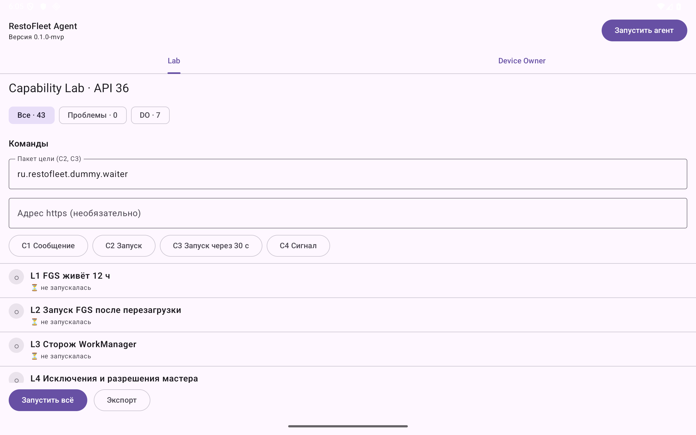
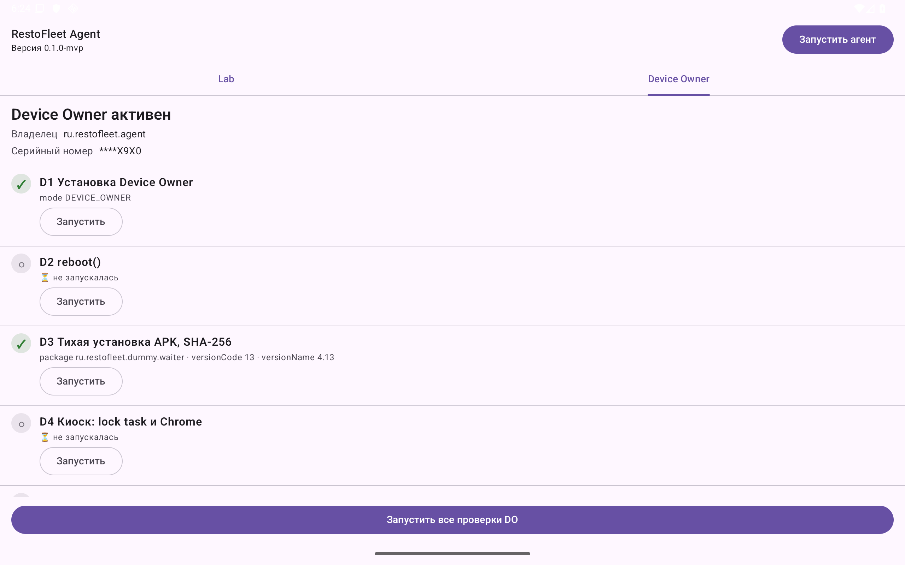
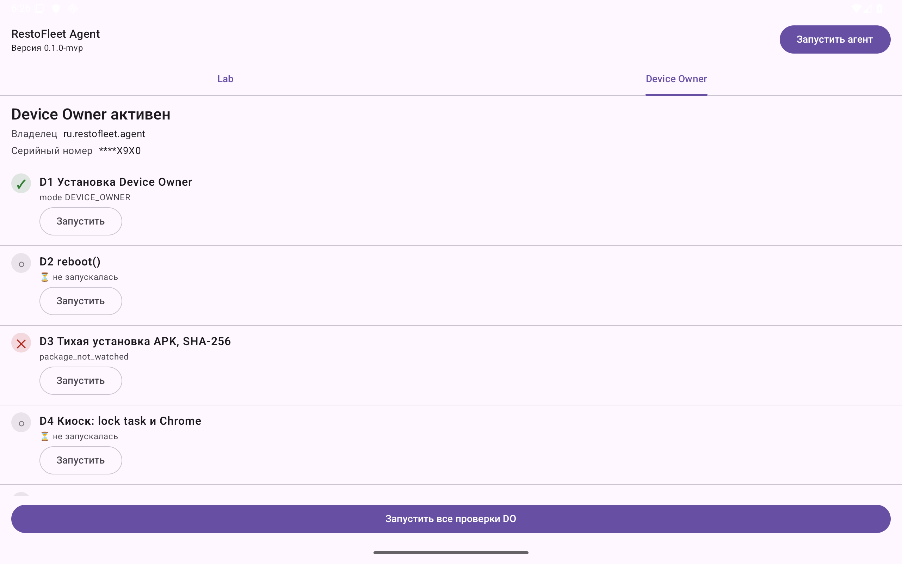
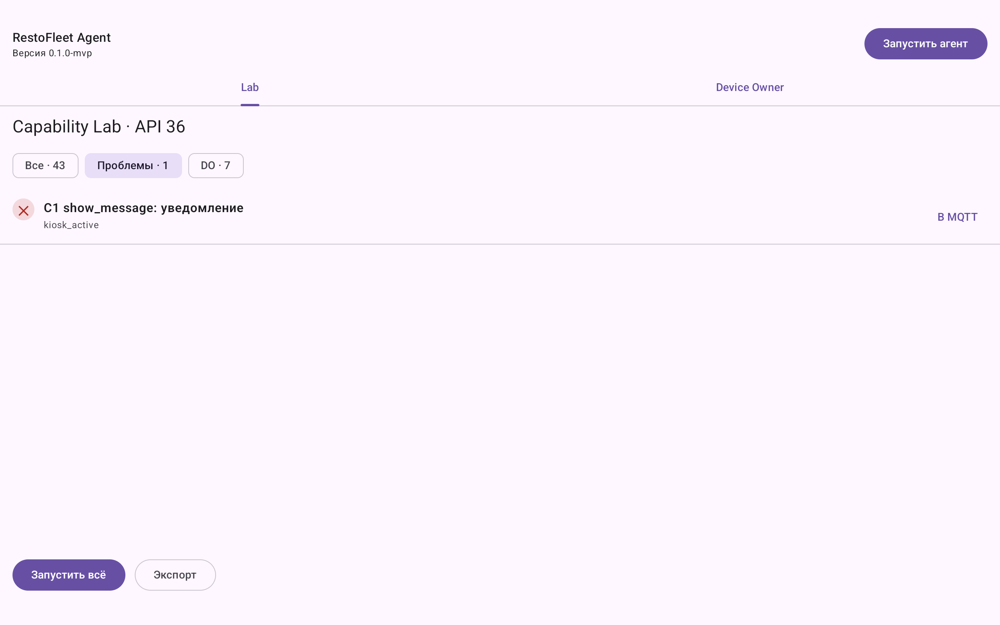
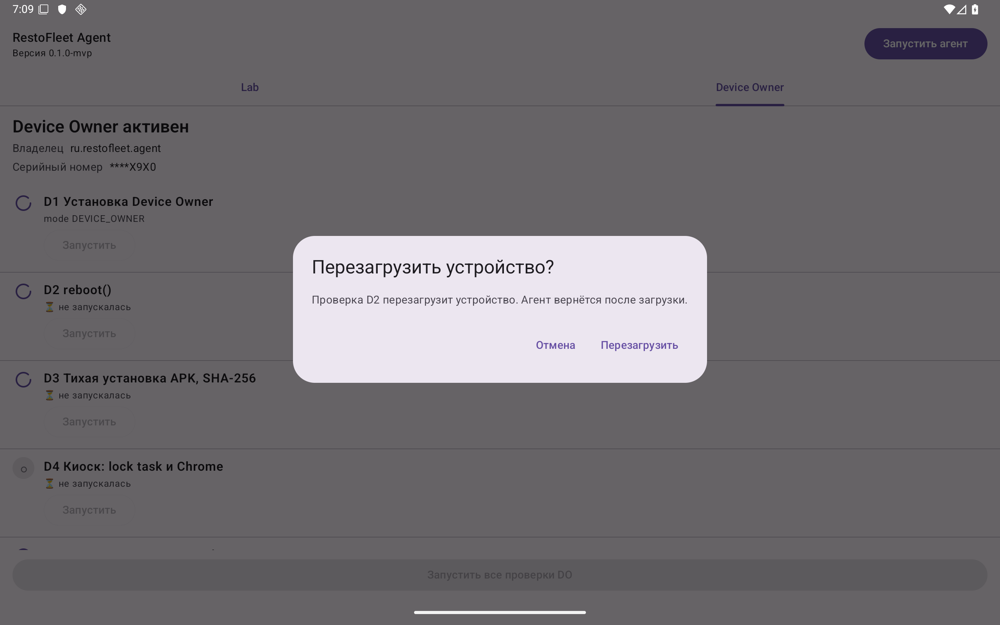

# Отчёт вехи M2 — Device Owner и команды

**Этап:** MVP-A · **Ветка:** `stage/0-mvp` · **Даты:** 07–09.11.2026 · **План:** `docs/superpowers/plans/2026-11-05-mvp-a.md`, задачи 2.1–2.6 · **Диапазон коммитов:** `6a3e48e..efbfffa` (задачи 2.1–2.5), исправления по ревью вехи — `9984620`, решения — `6a65ff6`. Задачи M3 3.1–3.5 к моменту закрытия уже выполнены поверх M2; цифры метрик ниже — по состоянию после 3.5 и исправлений.

## Цель вехи

Проверить на эмуляторах то, что нельзя проверить без роли Device Owner, и ввести команды агенту:
- доменные `Capabilities`, команды и `ExecuteCommand` (режим, формат аргументов, изоляция сбоев);
- адаптер Device Owner D1–D6, R10, R13 (перезагрузка, тихая установка APK с SHA-256, киоск, самовыдача разрешений);
- команды обычного режима C1–C4 (уведомление, запуск приложения, сигнал);
- экран Device Owner и секция «Команды» в Capability Lab.

## Что сделано

| Задача | Результат | Ключевые файлы |
|---|---|---|
| 2.1 | `Capabilities`, `Command`, `CommandOutcome`, `ExecuteCommand`; проверка формата URL, пакета, длин | `agent/domain/.../capability/Capabilities.kt`, `usecase/ExecuteCommand.kt` |
| 2.2 | Тестовое приложение `dummy-waiter` 4.13/4.14 и раздача APK (nginx по HTTPS, 8443) | `tools/dummy-waiter`, `deploy/apk-host` |
| 2.3 | `DpmDeviceAdmin`: reboot, установка через `PackageInstaller`, lock task, самовыдача разрешений; R10, R13 (серийный номер в маске) | `agent/data/.../deviceadmin/*.kt` |
| 2.4 | Команды C1–C4: уведомление, запуск через уведомление / overlay / DO, сигнал на `USAGE_ALARM` | `agent/data/.../command/*.kt` |
| 2.5 | Экран Device Owner (MVI) и секция «Команды» Lab; подтверждение перезагрузки первым шагом «Запустить все» | `agent/presentation/.../deviceowner/*`, `lab/*` |
| Исправления по ревью вехи | C1, I1–I3, m1–m4, m6 (частично), m7, m9; решения 140–147 | `9984620` |
| 2.6 | Этот отчёт, скриншоты, документы этапа, handoff | `docs/reports/0-mvp/M2.md`, `img/m2-*.png` |

## Решения

См. `decisions.md`: 89–119 — задачи 2.1–2.5, 140–147 — исправления по ревью вехи. Главные:
- **№ 140 (Critical):** привилегированная поверхность (экран DO, команды Lab, установка по URL) только в debug-сборке; в release её нет ни на экране, ни в графе Koin; защищено юнит-тестами release и проверкой манифеста.
- **№ 142:** двухфазный `reboot` — порт планирует перезагрузку через 3 с, итог команды кладётся в персистентный outbox, а не публикуется напрямую.
- **№ 143:** `install_update` ставит только отслеживаемый пакет; `setAppPackageName` отклоняет чужой APK; результат содержит версию.
- **№ 141:** под киоском `show_message` и `launch_app` чужого пакета честно отвечают `failed`/`kiosk_active`.
- **№ 119:** задержка C3/D5 — 30 с, вне окна гарантии фонового запуска; `DIRECT_DO` подтверждён на API 36.
- **№ 118:** «Запустить все» сначала спрашивает подтверждение перезагрузки, D2 выполняется последней, D4 в прогон не входит.
- **№ 144:** одно условие — один код: `notifications_disabled`.

## Метрики

Команды: `./gradlew build detekt koverVerifyCi :konsist-tests:test --continue` (`rc=0`), затем `./gradlew build koverHtmlReportCi koverXmlReportCi` (`rc=0`); тесты — суммы `tests/failures/errors/skipped` из `**/build/test-results/**/*.xml`; покрытие — `build/reports/kover/reportCi.xml`, разбивка по пакетам модулей.

| Модуль | Тестов | Строки | Ветви | Инструкции |
|---|---|---|---|---|
| `agent:domain` | 188 | 99,0 % (572/578) | 89,2 % (280/314) | 99,1 % |
| `agent:data` | 591 | 95,7 % (1797/1878) | 88,6 % (774/874) | 94,7 % |
| `agent:presentation` | 156 | 93,1 % (540/580) | 91,1 % (316/347) | 94,2 % |
| `agent:app` | 80 debug + 3 release | 100 % (94/94) | 85,7 % (18/21) | 100 % |
| `console:core:mvi` / `shared:*` / `konsist-tests` | 10 / 37 / 5 | 100 % / 100 % | | |
| **Проект целиком (корневой агрегат)** | **1070, 0 падений, 0 пропусков** | **96,2 % (3223/3350)** | 81,5 % (1587/1948) | 94,4 % |

- В 1070 входят тесты M3 (3.1–3.5); к 495 тестам на конец M1 добавилось 575, из них исправления по ревью M2 — около 60 (domain +30 вместе с киоском и reboot, data +50 с установкой, presentation +9, app +4 и 3 release-теста).
- Гейты: проект ≥ 80 %, `agent:domain`, `shared:*`, `console:core:mvi` ≥ 90 %; ветви платформенного пакета `agent:data` — 100 % (вариант `platform`). Строки `agent:presentation` ниже, чем в M1 (97,8 → 93,1 %): добавились Compose-файлы экрана DO и секции Lab, исключённые из покрытия только в части `@Composable`-фасадов.
- Исправления по ревью: один прогон `--rerun` для `agent:data` и `agent:app` (debug и release) — `rc=0`.
- Проверка release: `verifyReleaseNoDebugSurface` — мутации `testOnly` и `debuggable` в release-манифесте ловятся; задача подвешена на `packageRelease`, `bundleRelease`, `assembleRelease`.

### Проверки на эмуляторе `rf-api36-do` (API 36, после исправлений)

| Проверка | Результат |
|---|---|
| Debug: вкладка DO и секция «Команды» | есть; в release — нет (юнит-тест) |
| D3, пакет `ru.restofleet.dummy.waiter` | установлена 4.13, в результате `package · versionCode 13 · versionName 4.13` |
| D3, пакет `com.example.other` | `package_not_watched`, запрос к apk-host не отправлялся |
| D3, пакет `com.android.chrome` с APK waiter | `install_failed:4`, причина системы — в logcat |
| D4 → C1, C2 (чужой пакет) | `failed`/`kiosk_active`; выход из киоска — `am force-stop` цели |
| «Запустить все» → «Перезагрузить» | перезагрузка через ≈3,1–3,5 с после подтверждения (`reason: deviceowner`), агент и DO после загрузки на месте |

## Проблемы и как решены

- Ревью вехи нашло Critical (привилегированный экран DO попадал в release) и три Important (потеря результата `reboot`, ложный успех под киоском, `install_update` без пакета): исправлены, решения 140–143.
- Release-юнит-тесты AGP отключены по умолчанию: включены через `HostTestBuilder.UNIT_TEST_TYPE` и ограничены классами `*ReleaseTest`, чтобы не гонять общие тесты дважды.
- Нестабильность Robolectric в `agent:app` (нативная библиотека при смене SDK) — изоляция по классам `forkEvery = 1` (решение 106).

## Отклонения от плана

- Экран DO существует только в debug (в плане — «экран DO в Lab» без ограничения); доступ техника в release — кандидат в ТЗ v0.3.
- Параметр `package` в `install_update` добавлен к URL и хэшу из ТЗ (FR-AG-68 говорит об отслеживаемом приложении).

## Что осталось

- Восстановление киоска после перезагрузки и после `install_update`, команда выхода из киоска, `setLockTaskFeatures` — ТЗ v0.3 (решение 141).
- Очистка брошенных сессий установщика (m6), улики D5 с метками времени (m8), строки D2–D6 Lab не читают журнал (m10).
- C2 с URL в Chrome и D4 с Chrome не проверены (в `rf-api36` Chrome нет) — M4; C4 на слух — M4; D7 (QR) — 4.1; Back в lock task на API 26–27 — M4.
- Журнал ручных проверок Lab хранится в памяти: результат D2 после перезагрузки теряется (M3/M4).
- Фикстура `install_update` в `shared:protocol` с ключом `package`; `WatchedApps` из `shadow.watchedApps`; запуск `FlushOutbox` после `enqueue` итога `reboot` — задача 3.6.
- Ручная проверка на реальном планшете (сброс → `dpm set-device-owner`) — MVP-B.

## Тезисы для текста работы

1. **Device Owner как граница доверия.** Привилегированные операции (тихая установка, киоск, перезагрузка) требуют роли Device Owner, поэтому они вынесены за доменный порт `DeviceAdmin`; каждая операция адаптера сначала проверяет роль и не обращается ни к сети, ни к установщику без неё. Формат аргументов команды (https-URL, имя пакета, SHA-256, длины) проверяется в домене до порта и повторно — в адаптере, так как команда приходит по сети.
2. **Тихая установка APK.** Файл скачивается по HTTPS без смены схемы, сверяется SHA-256 (сравнение за постоянное время) и устанавливается через `PackageInstaller` из того же приватного файла; хэш из того же источника защищает от порчи, но не от подмены сервера, поэтому в командном пути хэш приходит отдельным каналом. Обновлять можно только отслеживаемое приложение: сессия создаётся с `setAppPackageName`, и система отклоняет APK другого пакета.
3. **Привилегированный интерфейс только в отладочной сборке.** Ревью вехи показало, что экран, позволяющий ввести произвольный URL APK, в release превращает агента на незапертом планшете в средство установки произвольного ПО. Поверхность вынесена в `debug`-модуль Koin, в release её нет в графе; это закреплено тестами обоих вариантов сборки и проверкой release-манифеста.
4. **Команда, результат которой нельзя отправить.** Перезагрузка уничтожает процесс раньше, чем ответ дойдёт до брокера, поэтому порт только планирует перезагрузку (через 3 с), а итог попадает в персистентную очередь исходящих сообщений и уходит после загрузки. Это отдельный случай общего правила at-most-once: команда помечается выполненной до исполнения, повторная доставка игнорируется.
5. **Честный отказ вместо ложного успеха.** Под киоском (lock task) системные уведомления скрыты и чужие приложения не запускаются, поэтому агент читает состояние киоска и отвечает `failed`/`kiosk_active`, а не `succeeded`. Одно и то же условие («уведомления выключены») имеет один код ответа на всех уровнях API.
6. **Фоновый запуск Activity.** Из фона запуск разрешён из `PendingIntent` уведомления, при `SYSTEM_ALERT_WINDOW` и для Device Owner; для Device Owner это не подтверждено документацией, поэтому проверено на API 36 с задержкой 30 с вне окна гарантии (решение 119).
7. **Результаты по метрикам.** К закрытию вехи в проекте 1070 unit-тестов без падений и пропусков (включая задачи M3 3.1–3.5), покрытие строк по Kover: `agent:domain` 99,0 %, `agent:data` 95,7 %, `agent:presentation` 93,1 %, `agent:app` 100 %, проект 96,2 %. Device Owner проверен на эмуляторе API 36: установка 4.13 с версией в результате, отказ для постороннего пакета, отказ установщика для чужого APK, перезагрузка через ≈3 с после подтверждения, отказ `kiosk_active` под киоском.
